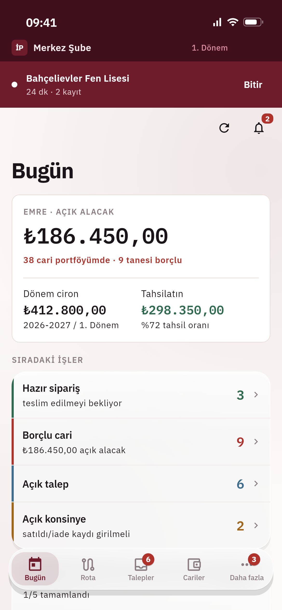
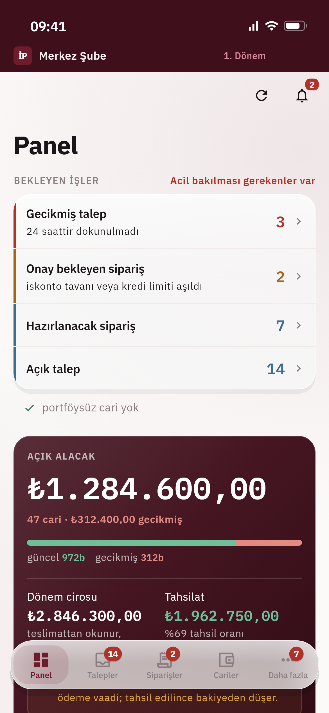
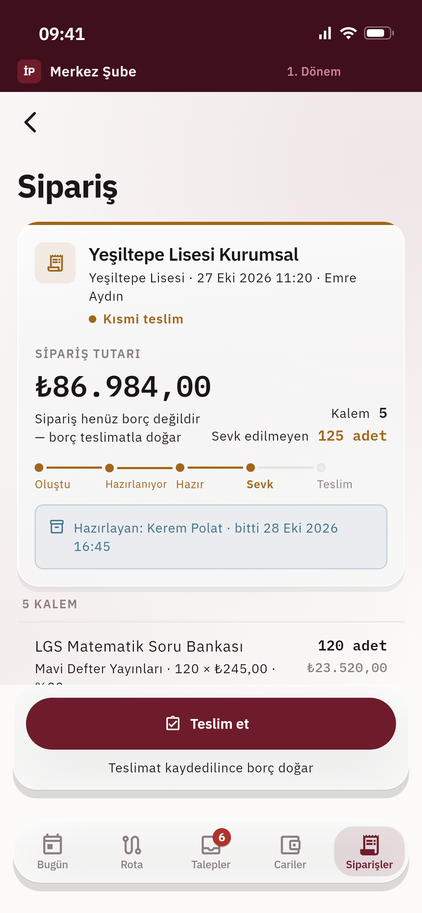
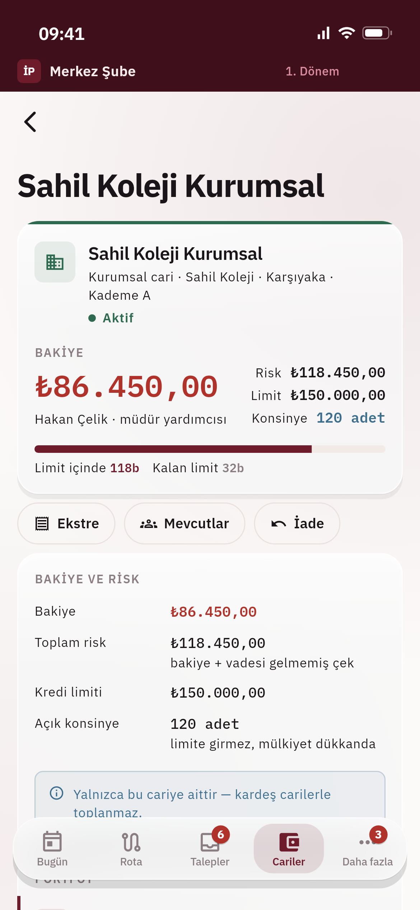

# İşlerPro

**Field sales and dealer management for school-channel book distributors.** Sales reps visit schools and tutoring centers, take orders, track deliveries and collect payments, offline in the field. Owners and store managers run catalog, pricing, reports and imports from the web panel.

One Flutter codebase: **Android · iOS · Web · macOS**, backed by **Supabase (PostgreSQL + Row Level Security)**.

> The UI and the design docs are in Turkish, since the product targets the Turkish market.

| Sales rep · today | Owner · dashboard | Order · partial delivery | Customer account |
|:---:|:---:|:---:|:---:|
|  |  |  |  |

<sub>Rendered from the real widgets with demo data (fictional schools, people and publishers), iPhone size. See [Testing](#testing).</sub>

## What it does

- **Multi-tenant by design:** a business owns one or more stores, each store has its own sales reps, and each rep has a portfolio of institutions and teachers. Every row in the database is scoped along that chain.
- **Two kinds of customers in the same school:** the school itself (bulk exam packages, institutional discount tier) and individual teachers (their own classes, teacher discount tier). Each has its own account, balance and consignment.
- **Field workflow:** visits, requests, orders, deliveries, returns, collections and checks, with a running account balance and risk limits per customer.
- **Exam calendar:** recurring practice-exam programs (e.g. 12 exams × 200 students, delivered every two weeks) planned on a calendar.
- **Catalog and pricing:** products with editions, a per-store price layer and tiered discount resolution.
- **Bulk import:** reads the messy Excel/CSV files bookstores actually have (`.xls`, `.xlsx`, `.csv`) and maps their columns onto the catalog.
- **Reports:** a report engine with Excel and PDF export.
- **Biometric session lock** for the app.

## Engineering highlights

### Offline-first, with a durable write queue

Sales reps work in schools with bad reception, so the mobile app writes locally first. Every write goes into a **local queue stored in SQLite (drift)**, not in memory: it survives app restarts and device reboots. Each entry carries a local sequence number and a client id, which together form an **idempotency key**, so uploading the same row twice never creates a duplicate on the server. The sync screen shows the queue in human terms ("Y High School · 3 line items"), not raw function names.

### Security in the database, not just in the UI

- **Row Level Security** on every table, following the tenant → store → customer-portfolio chain. A rep can only ever read and write their own portfolio, even if the client is tampered with.
- Business rules live in **Postgres functions**: balance calculation, risk checks, discount resolution, FIFO payment matching, accounting period locks.
- Local data encryption status is measured on device and shown to the user.
- Password login is a dev-only compile flag; release builds don't even draw the password field.

### Data model

39 SQL migrations under [`supabase/migrations/`](supabase/migrations/): 53 tables, 22 enums, functions and RLS policies, covering organizations and memberships, institution directory, customer accounts, catalog, commerce (visits → orders → deliveries → collections), exam programs, notifications, audit log and bulk imports.

### Decision log

The product mechanics document ([`docs/01-urun-mekanigi.md`](docs/01-urun-mekanigi.md)) records 50 numbered product decisions (K1–K50). The code cites them where they're implemented (e.g. `/// K43 · write queue`), so every non-obvious rule can be traced back to why it exists.

## Stack

| Area | Choice |
|---|---|
| State | Riverpod 3 |
| Navigation | go_router |
| Backend | Supabase (Postgres, Auth, RLS, RPC) |
| Local storage | drift (SQLite) |
| Models | freezed + json_serializable |
| Security | flutter_secure_storage, local_auth |
| Files | excel, pdf, file_picker |

## Project layout

```
lib/
  core/        auth, network, router, security, theme tokens, test keys
  data/        local DB + write queue, models, repositories, services (import, reports)
  features/    accounts · auth · catalog · collections · commercial · dashboard · exams
               import · institutions · notifications · onboarding · orders · reports
               requests · security · settings · sync · visits
  shared/      formatters, shared widgets
supabase/      config + SQL migrations
test/          unit and widget tests, API + RLS checks (test/e2e), demo data,
               README screenshot generator (test/ekran_goruntusu)
integration_test/  one end-to-end flow that runs on web, iOS, Android and desktop
design/        HTML design references for the web panel and mobile screens
docs/          product mechanics, data analysis, exam calendar, reporting, setup, test strategy,
               screenshots
```

## Testing

```bash
./dogrula.sh --hepsi
```

Four layers in one command:

| Layer | What it checks | Where |
|---|---|---|
| Static analysis | types, lints, dead code | `flutter analyze` |
| Unit + widget | business rules, screen behavior | `test/` |
| API + RLS | database functions and permission boundaries | `test/e2e/` |
| End-to-end | the real app against a real backend | `integration_test/` |

`integration_test` was chosen because the **same test file** runs in Chrome, the iOS simulator, the Android emulator and on desktop. Tests find widgets by stable keys from a single file (`lib/core/test_keys.dart`), never by visible text, so changing a label doesn't break them.

The screenshots above are widget tests too ([`test/ekran_goruntusu/`](test/ekran_goruntusu/)): the real shell, theme and fonts with fake repositories. They are skipped in the normal run; to regenerate them:

```bash
flutter test --tags ekran --run-skipped --update-goldens test/ekran_goruntusu
```

## Running it

1. Create a Supabase project and apply the migrations: `supabase db push`
2. Copy the env file and fill in your project URL and anon key:
   ```bash
   cp .env.example .env
   ```
3. Run:
   ```bash
   flutter run --dart-define-from-file=.env --dart-define=DEV_LOGIN=true
   ```

Without the defines the app still opens and shows a screen explaining what's missing. Step-by-step setup: [`docs/05-supabase-kurulum.md`](docs/05-supabase-kurulum.md).

> `docs/02-mevcut-veri-analizi.md` and `docs/03-deneme-takvimi.md` analyze the real source spreadsheets the product was designed from. Those files are not part of this public repository.

---

A Turkish README is in [README.tr.md](README.tr.md).

Built by **Muhammed Ali Çınar**, senior Flutter & iOS developer.
