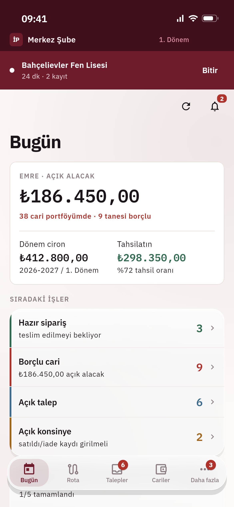
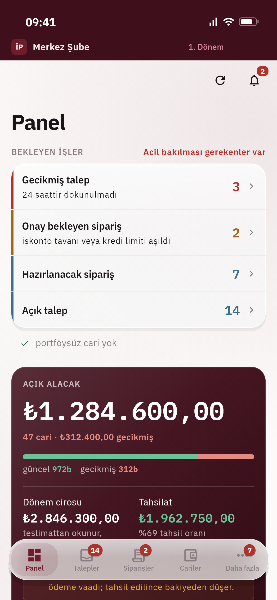
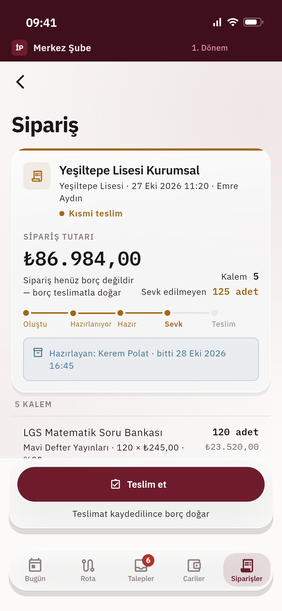
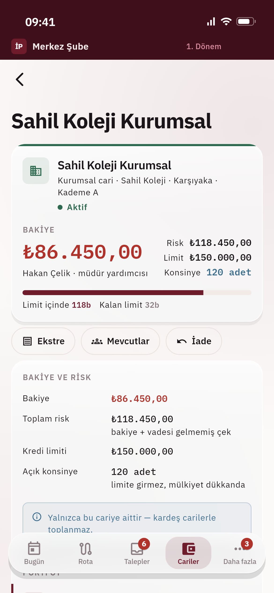

# İşlerPro

Okul kanalı kitap & deneme satışı için saha + bayi yönetim uygulaması.
Tek Flutter kod tabanı: Android · iOS · Web · macOS · Windows.

| Pazarlamacı · Bugün | Sahip · Panel | Sipariş · kısmi teslim | Cari |
|:---:|:---:|:---:|:---:|
|  |  |  |  |

<sub>Gerçek widget'lardan, demo veriyle (uydurma okul, kişi ve yayınevi adları) üretildi. Yeniden üretmek: [Doğrulama](#doğrulama).</sub>

## Dokümanlar

| Doküman | İçerik |
|---|---|
| [docs/01-urun-mekanigi.md](docs/01-urun-mekanigi.md) | Roller, veri modeli, akışlar, ekranlar, **K1–K50 kararları** |
| [docs/02-mevcut-veri-analizi.md](docs/02-mevcut-veri-analizi.md) | 755 kurum + 24.632 ürün analizi, içe aktarma planı |
| [docs/03-deneme-takvimi.md](docs/03-deneme-takvimi.md) | 267 deneme, takvim ekranı tasarımı |
| [docs/04-raporlama.md](docs/04-raporlama.md) | Rapor motoru, katalog, Excel/PDF çıktı |
| [docs/05-supabase-kurulum.md](docs/05-supabase-kurulum.md) | Supabase bağlantısı — adım adım |
| [docs/06-test-stratejisi.md](docs/06-test-stratejisi.md) | **Test katmanları ve çalıştırma** |

## Çalıştırma

```bash
cp .env.example .env     # değerleri Supabase panelinden doldur
```

Terminalden:

```bash
flutter run --dart-define-from-file=.env --dart-define=DEV_LOGIN=true
```

`--dart-define-from-file` `.env`i olduğu gibi okur; anahtarların ayrıca bir
yere kopyalanması gerekmez. `DEV_LOGIN` parolayla girişi açar ve yalnızca
geliştirmede verilir — sürüm derlemesinde bu tanım olmadığı için parola alanı
hiç çizilmez.

`.env` yoksa Flutter daha başlamadan `Did not find the file passed to
"--dart-define-from-file"` der — ilk adımı atlamışsın demektir.

Ayrıntı: [docs/05-supabase-kurulum.md](docs/05-supabase-kurulum.md)

Tanımlar hiç verilmezse (düz `flutter run`) uygulama açılır ama gerçek giriş
yapılamaz; neyin eksik olduğunu söyleyen bir ekran gelir.

## Doğrulama

```bash
./dogrula.sh --hepsi
```

Dört katman: statik analiz · birim/widget · API+RLS · uçtan uca (web + iOS).
Ayrıntı: [docs/06-test-stratejisi.md](docs/06-test-stratejisi.md)

Yukarıdaki ekran görüntüleri de birer widget testi (`test/ekran_goruntusu/`):
gerçek kabuk, tema ve yazı tipleri, sahte depolar. Normal koşuda atlanır;
yeniden üretmek için:

```bash
flutter test --tags ekran --run-skipped --update-goldens test/ekran_goruntusu
```

## Veritabanı

`supabase/migrations/` altında 39 dosya sırayla uygulanır. Temel şema ilk
dokuzunda; sonrakiler akışları (talep, sipariş, teslimat, tahsilat), ziyaret ve
rotayı, çevrimdışı senkronu, deneme takvimini ve rapor motorunu ekler.

| Dosya | İçerik |
|---|---|
| `0001_enums.sql` | 22 enum tipi |
| `0002_org.sql` | Profil, işletme, dükkan, üyelik, **dönem** (K8), davet, KVKK onayı |
| `0003_directory.sql` | Kurum dizini (K18), kişiler (K30), yayınevleri |
| `0004_accounts.sql` | **Cari** (K5), taşıma günlüğü (K6), sınıf mevcutları (K22), portföy |
| `0005_catalog.sql` | Ürün + baskı (K23), dükkan fiyat katmanı (K12), iskonto (K25) |
| `0006_commerce.sql` | Ziyaret, talep, sipariş, teslimat, iade, tahsilat, çek |
| `0007_exams_system.sql` | Deneme programları (K47), bildirim, audit, **toplu aktarma** (K49), rapor (K50) |
| `0008_functions.sql` | Bakiye (K29), risk (K11), iskonto çözümleme (K25), FIFO mahsup (K48), dönem kilidi (K8) |
| `0009_rls.sql` | Satır düzeyi güvenlik — tenant → dükkan → cari portföyü zinciri |

```bash
supabase db push
```

> Toplam 53 tablo · 22 enum. Fonksiyonlar ve RLS sınırları gerçek bir Supabase
> projesine karşı `test/e2e/` ile sınanır (`./dogrula.sh --e2e`); ilk kurulumun
> kaydı [docs/05-supabase-kurulum.md](docs/05-supabase-kurulum.md).

## Tasarım

Referans tasarım: `design/web-panel.dc.html` · belirteçler: `lib/core/theme/tokens.dart`

Bordo `#6E1B2C` marka rengi, sıcak nötr zeminler, **gölgesiz** düz yüzeyler
(ayrım 1px kenarlıkla), IBM Plex Sans + Mono (gömülü). Sayısal alanlar
monospace + tabular figür ile hizalı.

## Mimari

```
lib/
  core/     auth · network · router (rol guard) · security · theme · test kimlikleri
  data/     local (drift + yazma kuyruğu) · models · repositories · services
  features/ accounts · auth · catalog · collections · commercial · dashboard ·
            exams · import · institutions · notifications · onboarding · orders ·
            reports · requests · security · settings · sync · visits
  shared/   formatters · widgets
```

Responsive: `<600px` BottomNav · `600–1024` NavigationRail · `>1024` kalıcı sidebar.
