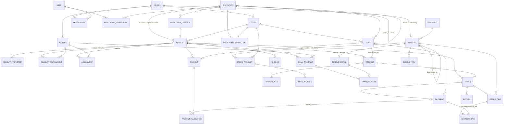

# İşlerPro — Ürün Mekaniği

> Okul kanalı kitap & deneme satışı için saha + bayi yönetim uygulaması.
> Hedef platformlar: Android, iOS, Web (Sürüm 1) → macOS (Faz 10).
> **Windows 27 Ağustos 2026'da kapsam dışı bırakıldı** (kullanıcı kararı).

---

## 1. İş modeli özeti

Bir **işletme sahibi**nin bir veya birden çok **kitap dükkanı** vardır. Her dükkanın
kendi **pazarlamacı**ları vardır. Pazarlamacılar portföylerindeki **kurum**ları —
okullar *ve* özel kurs merkezleri (dershane, etüt merkezi) — ziyaret eder;
kitap ve deneme satar, **öğretmen**lerden yeni talep toplar.

> **Kapsam (gerçek veriden doğrulandı):** okul kütlesinin **%72'si ilkokul + ortaokul**
> (357 ilkokul, 183 ortaokul, 124 lise, 69 anaokulu). Ürün kataloğunun en kalabalık
> sınıfı **8. sınıf**. Yani **LGS en az YKS kadar merkezî**. Sınıf aralığı **1-12 + mezun**,
> okul türü listesi anaokulundan liseye tüm kademeleri kapsar.
> Ayrıntı: [02-mevcut-veri-analizi.md](02-mevcut-veri-analizi.md)

Para akışı iki koldan gelir:
1. **Kitap satışı** — tek seferlik, adet bazlı.
2. **Deneme satışı** — dönemsel/abonelik benzeri (ör. 12 deneme × 200 öğrenci, 2 haftada bir teslim).

Satışın **iki farklı muhatabı** olabilir ve ikisi aynı okulda paralel yürür:

| Muhatap | Örnek | Cari kime | Fiyat |
|---|---|---|---|
| **Kurumsal (kurum)** | Okul veya dershane 400 öğrenci için deneme paketi alır | Kuruma | Kurumsal iskonto kademesi |
| **Bireysel (öğretmen)** | Matematik öğretmeni kendi 3 sınıfı için 90 kitap alır | Öğretmene | Öğretmen iskonto kademesi |

Yani bir pazarlamacı **hem okulla hem o okuldaki birkaç öğretmenle ayrı ayrı**
çalışabilir. Her birinin kendi carisi, kendi bakiyesi, kendi konsinyesi vardır.

---

## 2. Roller ve kapsam (scope) zinciri

```
Platform Admin
└── İşletme (tenant)            ← Dükkan Sahibi
    ├── Dükkan A (store)        ← Dükkan Müdürü (ops.)
    │   ├── Pazarlamacı 1  → portföy: [Okul X kurumsal] + [X/Ahmet Öğr.] + [X/Ayşe Öğr.] + [Okul Y]
    │   └── Pazarlamacı 2  → portföy: [Okul Q] + [Q/Mehmet Öğr.]
    └── Dükkan B
        └── Pazarlamacı 3

Okul (global dizin)  ←→  Öğretmen / Okul Yetkilisi
```

| Rol | Nerede çalışır | Görebildiği veri |
|---|---|---|
| **Platform Admin** | Web | Tüm tenantlar, global katalog & kurum dizini |
| **İşletme Sahibi** | Web + mobil özet | Kendi tenantının tüm dükkanları |
| **Dükkan Müdürü** *(Faz 1)* | Web + mobil | Tek dükkan |
| **Pazarlamacı** | **Mobil (offline)** | Kendi dükkanı + portföyündeki kurumlar |
| **Öğretmen / Kurum Yetkilisi** | Mobil + web | Kendi kurumunun, kendi çalıştığı dükkanla olan kayıtları |
| **Hazırlık / Sevkiyat** *(opsiyonel, Faz 4)* | Web + tablet | Tek dükkanın **hazırlanacak siparişleri** (K46). Zorunlu rol değildir — küçük dükkanda müdür yürütür |

### Kritik mimari karar: kurum global, ticaret tenant'a özel

`institutions` tablosu **paylaşımlı dizin**dir — okul *ve* kurs merkezi birlikte
(K18): ad, kurum tipi, il/ilçe, MEB kodu, konum. Talep, sipariş, bakiye gibi
ticari veri `tenant_id` ile izole edilir.

Kazanç:
- Aynı kurum iki farklı dükkanla çalışabilir; veri karışmaz.
- Öğretmen **tek hesapla** birden çok dükkandan talep açabilir.
- Kurum dizini zamanla ortak varlık hâline gelir (yeni dükkan sıfırdan veri girmez).

### Yetki kuralı (tek cümle)

> Her sorgu `tenant_id` ile filtrelenir. Pazarlamacı ek olarak `assignments`
> tablosundaki **cari (account) listesiyle** sınırlanır. Öğretmen ise kendi carisini
> görür; okul adına yetkiliyse kurumsal cariyi de görür.

Portföy okul değil **cari** bazlıdır. Böylece okulun kurumsal işini kıdemli bir
pazarlamacı, aynı okuldaki öğretmen ilişkilerini başka bir pazarlamacı yürütebilir.

**Fiyat gizliliği:** Pazarlamacı alış/bayi fiyatını **görmez**; sadece satış fiyatını
ve verebileceği maksimum iskonto oranını görür. Limit aşan iskonto → sahibe onaya düşer.

---

## 3. Veri modeli



> ERD, §3'teki tablo gruplarının görselidir. **Tek doğru kaynak tablo gruplarıdır**;
> çelişki hâlinde metin kazanır (Y-10).


### Tablo grupları

**Kimlik & organizasyon**
- `users` — global hesap (telefon birincil, e-posta ikincil)
- `tenants` — işletme (unvan, vergi no)
- `stores` — dükkan/şube (il, ilçe, adres)
- `memberships` — `user_id · tenant_id · store_id · role · status` → **bir kullanıcı birden çok rolde olabilir**
- `institution_memberships` — `user_id · institution_id · role (öğretmen/müdür yrd./rehber) · branş · can_order_for_institution` (kurum adına talep açma yetkisi, K3)
- `invites` — davet kodu / QR ile katılım

**Dizin**
- `institutions` — **kurum dizini** (K18). Okul *ve* özel kurs merkezlerini birlikte tutar:
  - `kurum_tipi` — `okul` \| `kurs_merkezi` \| `diger`
  - `ad · il · ilce · adres · meb_kodu · lat/lng · host` (slug)
  - `parent_id` **nullable** — **kurum zinciri**: "X Dershanesi" merkez, altında şubeler
  - `kademe` — yalnızca `kurum_tipi = okul` için (anaokulu/ilkokul/ortaokul/lise)
  - `tur` — okulda Anadolu/Fen/İmam Hatip/Meslek/Özel; kursta dershane/etüt/kurs
  - `hedef_sinavlar[]` — yalnızca `kurs_merkezi` için (LGS/TYT/AYT/KPSS…)
  - `ogrenci_sayisi` — kurs merkezleri genelde net bilir, okullar tahminî
  - `merged_into_id` **nullable** — mükerrer kurum birleştirme (ürünlerdeki K9
    mantığının aynısı: silme değil yumuşak yönlendirme, geçmiş kayıtlar bozulmaz)

  **Kim ekler, kim onaylar:** dükkan kullanıcısı yeni kurum ekleyebilir; kayıt
  `dogrulanmadi` durumunda başlar ve yalnızca o işletmeye görünür. Platform Admin
  doğrulayınca ortak dizine geçer. Ekleme anında **ad + ilçe** ile benzerlik
  araması yapılır ve muhtemel eşleşmeler gösterilir.

- `institution_store_links` — kurum ↔ dükkan ticari ilişkisi. **`accounts.store_id`
  bundan türetilmez, bağımsızdır**: link *"bu dükkan bu kurumla çalışıyor"* der,
  cari *"bu dükkanda şu muhatabın hesabı var"* der. Bir kurumla çalışılıyor ama
  henüz cari açılmamış olabilir
- `institution_contacts` — **`tenant_id` ZORUNLU** (K30): kurumdaki kişiler
  (uygulama hesabı olmayanlar dâhil), telefon/branş/not. Kurum dizini ortaktır ama
  **kişi kayıtları ve notlar ortak değildir** — aksi hâlde bir dükkânın portföy
  bilgisi rakibine sızar
- `publishers` — yayınevi

**Dönem (periods) — takvim omurgası**

`periods` — tenant bazlı, yılda **2 kayıt**:

| Alan | Örnek |
|---|---|
| `academic_year` | `2026-2027` |
| `term` | `1` \| `2` |
| `name` | `2026-2027 / 1. Dönem` |
| `starts_on` – `ends_on` | 1 Eylül – 31 Ocak · 1 Şubat – **31 Ağustos** |
| `status` | `planlandi` \| `aktif` \| `kapali` |

> **2. dönem neden 31 Ağustos'a kadar sürer:** okul Haziran'da kapanır ama yaz
> satışı (gelecek yılın kitapları, yaz kursları) Temmuz-Ağustos'ta devam eder.
> Dönem o tarihe kadar açık kalır ki **hiçbir işlem dönemsiz kalmasın**.

`period_id` referans alan tablolar: `assignments` · `exam_programs`

> **Damgalama kuralı:** işlem satırlarına (`orders`, `shipments`, `payments` …)
> `period_id` **oluşturulma anında damgalanır** — tarihten sorgu zamanında türetilmez.
> K6'daki `institution_id` snapshot'ıyla aynı mantık: dönem sınırını sonradan kaydırdığında
> geçmiş kayıtlar yerinden oynamaz.

#### Tarihleri sonradan değiştirebilir miyiz?

Evet. `starts_on` / `ends_on` sıradan sütunlardır, düzenlemek göç
gerektirmez. Maliyet tablosu:

| İşlem | Maliyet |
|---|---|
| `planlandi` dönemin tarihlerini değiştir | **Serbest** |
| `aktif` dönemin `starts_on`/`ends_on`'unu kaydır | İzinli; sınır dışında kalan damgalı işlem varsa **uyarı + "yeniden damgala" seçeneği** |
| `kapali` dönemin tarihleri | **Kilitli.** Değişiklik için "dönemi yeniden aç" (yetki: işletme sahibi, audit log'a yazılır) |
| Yıl başına dönem sayısını değiştirmek (2 → 3, ör. **yaz dönemi** eklemek) | **Sadece satır ekleme.** Kod hiçbir yerde "2 dönem" varsaymaz |
| Geçmiş bir dönemi geriye dönük ikiye bölmek | **Veri göçü** — `period_id` yeniden damgalama scripti. Tek pahalı senaryo |

**Bunu ucuz tutan tasarım garantileri** (Faz 0'da uygulanır):

- `term` **smallint**'tir, `CHECK (term IN (1,2))` **konmaz** — sadece sıralama alanıdır
- Benzersizlik: `unique(tenant_id, academic_year, term)` — "yılda tam 2 kayıt" kısıtı yok
- Dönem listesi kodda sabit değil, **her zaman DB'den** okunur
- Hiçbir ekran/rapor tarihten dönem hesaplamaz; damgalı `period_id`'yi kullanır

> Yani "yaz dönemi de ekleyelim" dediğin gün yapılacak iş: bir satır eklemek.
> Değişmeyecek tek şey, **geçmişin geçmişte kalması**.


> **Hedef ve prim tabloları yoktur** (K35). Prim modülü kapsam dışıdır;
> pazarlamacı performansı yalnızca **rapor** olarak gösterilir (ciro, ziyaret
> sayısı, talep→sipariş dönüşümü), tahakkuk hesaplanmaz.

**Cari / muhatap (accounts) — merkezi soyutlama**

`accounts` tek tablo, üç tip:

| Alan | Açıklama |
|---|---|
| `tenant_id`, `store_id` | cari daima bir dükkana aittir — ticari veri tenant'a özel |
| `type` | `kurum` \| `ogretmen` \| `diger` |
| `institution_id` | her iki tipte de dolu — **bağlam bağı**: navigasyon, ziyaret planlama, cari taşıma. **Mali toplama için değil** (bkz. K7) |
| `institution_contact_id` | öğretmen carisinde dolu — **uygulama hesabı olmasa da** cari açılabilir |
| `user_id` | öğretmen uygulamaya kayıtlıysa dolu |
| `discount_tier` | cariye tanımlı iskonto kademesi — kurumsal/bireysel farkı buradan (K25 çözümleme sırası) |
| `credit_limit` | limit cari bazlı |
| `balance_cache` | **türetilmiş değer** (K29): `Σ borçlandıran sevkiyat − Σ tahsilat − Σ iade`. Yazan tek yer bir veritabanı fonksiyonudur; ekranlar okur, hiçbir uygulama kodu yazmaz |
| `invoice_title`, `tax_id`, `tax_office` | fatura kimliği — kurum: vergi no + dairesi, öğretmen: TCKN. **TCKN zorunlu değildir** (Y-14): yalnızca şahıs faturası kesilecekse ve o anda istenir. Kişi eşleştirmesi `user_id` üzerinden yapılır, TCKN yedek anahtar olarak **kullanılmaz** |
| `status` | `aktif` \| `pasif` \| `tahsilatta` \| `kapali` |

**Talep, sipariş, tahsilat, iade, konsinye stoğu ve deneme programı — hepsi
`institution_id`'ye değil `account_id`'ye bağlanır.** Bakiye, limit ve risk de
her zaman cari bazlıdır; okul düzeyinde **toplanmaz**.

- `account_transfers` — cari taşıma günlüğü: `account_id · from_institution_id ·
  to_institution_id · tarih · yapan kullanıcı · gerekçe`. Hiçbir hareket silinmez.

> **Snapshot kuralı (K6):** `requests`, `orders`, `shipments`, `payments`,
> `returns` satırlarına oluşturulma anındaki `institution_id`
> **kopyalanır**. Raporlar bu snapshot'tan okur, `accounts.institution_id`'den değil.
> Güncel görünüm (portföy, cari kartı) `accounts.institution_id` kullanır.

**Katalog**
- `products` — `tenant_id` **nullable** (NULL = ortak katalog, dolu = **işletmeye** özel),
  `type: kitap | deneme | set | dijital`, yayınevi, ISBN/barkod, `sinif[]` (**1-12 + mezun**),
  sınav tipi (TYT/AYT/YDT/YKS/LGS/KPSS/DGS/ALES), ders, **etiket fiyat (yayınevi listesi — referans)**,
  `merged_into_id` **nullable** (mükerrer birleştirme), `arsivlendi` (K14)
- **Baskı alanları** (K23, `products` üzerinde): `baski_etiketi` (metin: `2025-26`,
  `3. Baskı`) · `baski_sirasi` (smallint) · `baski_grubu_id` (uuid, nullable).
  Üçü de **elle** doldurulur; import'ta boş gelir
- `deneme_details` — `katalog = deneme` ürünleri için 1:1 yan tablo (alanları K20'de)
- `bundle_items` — set içeriği
- `store_products` — **dükkana özel ticari katman**: `store_id · product_id ·
  alis_fiyat · satis_fiyat · varsayilan_iskonto · aktif · **stok_takibi**`.
  Ürün kimliği paylaşılır, ticari koşullar paylaşılmaz (K12)
- `discount_rules` — iskonto kuralları: `tier · account_tip (kurum|ogretmen) ·
  publisher_id · product_id · min_adet → iskonto_orani · oncelik`.
  **`tier` doluysa yalnızca o kademedeki cariye uygulanır ve diğer kuralları
  ezer** — `accounts.discount_tier` ile eşleşir. `tier` boşsa kural geneldir.
  Ayrıca `discount_caps` — pazarlamacı iskonto tavanı (aşılırsa sipariş onaya düşer).

  > Uygulamada bulunan hata (bkz. `docs/06`): kademe ilk yazımda sorguda
  > kullanılmıyordu ve kademesi olan cari, genel kuralı da kaybediyordu.
  > İkisi de %10 varsayılana düşüyordu; ölçülerek doğrulandı ve düzeltildi.

**Saha**
- `assignments` — pazarlamacı ↔ **cari** portföyü, `period_id` bazlı (geçmiş dönemler korunur)
- `visits` — ziyaret: `checked_in_at` / `checked_out_at` **saat damgası**, kurum, görüşülen kişi,
  not, sonuç. **Konum, imza ve fotoğraf sütunu yoktur** — veri minimizasyonu (K10, K32)
- `visit_plans` — rota planı
- **`visit_id` damgası (Y-18)**: `requests · orders · shipments · payments ·
  institution_contacts` tablolarına **nullable `visit_id`**. Ziyaret açıkken oluşan
  her kayıt otomatik damgalanır — pazarlamacıya ek iş çıkmaz. K10'un
  "ziyaret kalitesi = çıktı sayısı" ölçütü bu alan olmadan hesaplanamaz

**Talep → Sipariş**
- `requests` — `account_id` · kaynak (öğretmen \| pazarlamacı) · `institution_id` (snapshot) ·
  `period_id` · `visit_id` (nullable) · durum
- `request_items` — **kalem bazında durum** (K37): `product_id` (zorunlu, serbest metin yok) ·
  `adet` · `durum: beklemede | onaylandi | reddedildi` · `red_nedeni`
- `quotes` — fiyatlı teklif. **Sürüm 1'de yoktur** (T-4): talep doğrudan siparişe
  dönüşür, `teklif_verildi` durumu durum makinesinde bulunmaz. Ayrı bir
  teklif belgesi gerekirse Sürüm 2'de değerlendirilir
- `orders` — `type: satış | konsinye | numune` · `account_id` · `institution_id` (snapshot) ·
  `period_id` (damga) · `visit_id` (nullable) · durum
- `order_items` — **fiyat ve maliyet damgalı** (K28): `product_id · adet · birim_fiyat ·
  iskonto_orani · **birim_maliyet** · satir_tutari`. Üçü de **sipariş anında kopyalanır**;
  `store_products` sonradan değişse geçmiş sipariş oynamaz. Aynı ilke `request_items`,
  ve `shipment_items` için de geçerlidir
- `shipments` — teslimat kaydı: `account_id` · `teslim_alan_ad` · `teslim_edildi_at` ·
  **`tip: teslimat | konsinye_satis | numune`** (C-1) ·
  **`kaynak: depo | elden`** (pazarlamacı yerinde mi verdi, depodan mı sevk edildi — bilgi alanı) ·
  kısmi teslim · `belge_no` (**opsiyonel** — dışarıda kesilmiş belge varsa referans, K33) ·
  `borclandirir` (satış teslimatı **evet**, konsinye teslimatı **hayır**).
  **İmza ve fotoğraf yoktur** (K32) — kişisel veri toplanmaz
- `shipment_items` — **fiyat ve maliyet damgalı**, `order_items` satırından kopyalanır
- **Backorder ayrı varlık değildir**: `order_items.adet` ile teslim edilen toplamın
  farkıdır (`kalan = adet − Σ shipment_items.adet`). Sipariş, tüm kalemlerin kalanı
  sıfırlanınca `kapandi` olur; kalan varsa `kismi_teslim` durumunda bekler
- `returns` — iade. Kural K26'dan doğrudan çıkar: **borçlandıran bir teslimatın
  iadesi bakiyeyi azaltır**; konsinye teslimatı zaten borçlandırmadığı için
  konsinye iadesi bakiyeye dokunmaz, yalnızca **kalan konsinyeyi azaltır** (türetilmiş)
- `payments` — **tahsilat olayı** (K48): `account_id · tarih · tutar ·
  `yontem: nakit | havale | kart | cek | senet` · `alan_user_id` · `not` ·
  `period_id` · `visit_id` (nullable) · `makbuz_no`
- `payment_allocations` — `payment_id · shipment_id · tutar`. Hangi tahsilatın
  hangi teslimata mahsup edildiğini taşır; bakiyenin tek doğru kaynağı budur
- `cheques` — **çek/senet yaşam döngüsü** (K11): `account_id` (kimden alındı) ·
  `type: cek | senet` · `kesideci` · `banka` · `sube` · `cheque_no` · `due_date` ·
  `amount` · `status` · `endorsed_to` (ciro edildiyse) · `period_id`

**Stok**
Stok **iki farklı ağırlıkta** tutulur (K27):

**1. Depo stoğu — hafif, bilgi amaçlı**
- `store_products.stok_adedi` — **sayaçtır, defter değildir** (C-2):
  - **Excel yüklemesi** sayacı sıfırdan yazar — bu bir *mutabakat anıdır*
  - **Her teslimat sayacı düşürür** (`tip = teslimat` olanlar)
  - Sipariş açarken gösterilir ama **engellemez**; yanlışsa satış durmaz

  > Teslimat sayacı düşürmeseydi Excel'i pazartesi yükleyip salı 200 kitap
  > teslim ettiğinde ekran hâlâ pazartesinin sayısını gösterirdi ve bir hafta
  > sonra gösterilen adet tamamen anlamsız olurdu. Sayaç güncellemek defter
  > tutmak değildir — K27'nin felsefesi bozulmaz.

**2. Konsinye — kayıtlardan türetilir, defteri yoktur**

`stock_items` ve `stock_movements` **yoktur** (K45). Konsinye üç olay kaydından ibarettir:

```
1. Konsinye teslimatı   shipments (tip=teslimat,       borclandirir=false)  → bırakılan
2. "Satıldı" kaydı      shipments (tip=konsinye_satis, borclandirir=true)   → borç doğar
3. İade kaydı           returns                                             → bakiye değişmez

Kalan konsinye = Σ(1) − Σ(2) − Σ(3)      ← türetilir, hiçbir yerde yazılmaz
```

> **`tip` ile `borclandirir` neden ayrı iki alan (C-1):** "satıldı" kaydı fiziksel
> bir teslimat **değildir** — daha önce bırakılmış malın yeniden sınıflandırılmasıdır.
> Tek bayrakla ayırt edilemez ve *"bu kitap kimlere kaç adet verildi"* raporu şişer
> (5 bırakılan + 3 satılan = 8 görünür, oysa okula giden 5'tir).
>
> ```
> Fiziksel hareket raporları → yalnızca tip = teslimat sayılır
> Bakiye hesabı              → borclandirir alanına bakar
> ```
> İki bayrak bağımsızdır; her iki soru da doğru cevaplanır.

Bakiye nasıl türetiliyorsa (K29) konsinye de öyle türetilir. Ayrı defter,
sayım fişi ve mutabakat töreni yoktur.

**Pazarlamacı zimmeti bir stok konumu DEĞİLDİR (K34).** Pazarlamacı mal taşır ve
yerinde teslim eder, ama üzerindeki bakiye takip edilmez — kaydedilen şey
**teslimat olayıdır**:

```
Pazarlamacı okulda kitap verdi
   → shipment kaydı:  ne (product_id) · kaç adet · ne zaman · kime (account_id)
                      kaynak = elden        (depo'dan sevkte: kaynak = depo)
                      borclandirir = true   → borç anında doğar (K26)
   → zimmet bakiyesi diye bir şey yok: sayım yok, fire yok, sorumluluk kaydı yok
```

Bu ayrım bilinçlidir: *"pazarlamacının üzerinde kaç kitap var"* bir stok
muhasebesi sorusudur ve K27 gereği kapsam dışıdır. *"Kime ne verildi"* ise
ticari kayıttır ve tam olarak tutulur.

**Teslimat kaydından çıkan iki rapor** — istenen şey tam olarak bunlar:

```
Cari bazlı  → "Y Lisesi'ne bu dönem ne verildi?"    account_id ile
Ürün bazlı  → "Bu kitap kimlere kaç adet verildi?"  product_id ile
```

Her ikisi de `shipment_items` üzerinden tek sorguyla çıkar; ayrı bir defter gerekmez.

**Portföy devri zorunludur.** Pazarlamacı pasife alınırken `assignments`
satırları sahipsiz kalırsa o carilerden gelen talepler **hiçbir gelen kutusuna
düşmez** — öğretmen talep açar, kimse görmez, 24 saat sonra sahibe anlamsız bir
SLA uyarısı gider. Bu yüzden pasife alma ekranı zorunlu bir adım içerir:

```
Pazarlamacıyı pasife al → "Portföyündeki 37 cari kime devredilecek?"
                        → tek seçim → assignments'a yeni satır (dönem bazlı)
                        → eski satırlar kapanır, geçmiş bozulmaz
                        (zimmet sayımı yok — K34)
```

**Dükkanlar arası transfer:** `store_products.stok_adedi` üzerinde **iki taraflı elle
düzeltme**dir; ayrı defter tutulmaz. Hafif stok felsefesiyle (K27) tutarlıdır —
depo stoğu zaten hareket defteri tutmuyor.

> **Kapsam dışı (K27):** tedarikçi, satınalma siparişi, mal kabul, yayınevine iade.
> `alis_fiyat` elle/Excel ile girilir ve sipariş anında `order_items.birim_maliyet`
> olarak **damgalanır** (K28). Damga olmasaydı Excel her güncellendiğinde geçmiş
> satışların kârı da değişirdi.

**Deneme (bu işin ayırt edici modülü)**
- `exam_programs` — **cari** + `period_id` + öğrenci sayısı + deneme adedi + periyot + birim fiyat. Yıllık anlaşma = **2 program** (her yarıyıl için bir tane). Kalemleri **yalnızca `katalog = deneme` ürünlerinden** seçilir
- `exam_deliveries` — takvimden üretilen kalem: ne zaman, hangi deneme, kaç adet,
  **`durum`** (K47) · `planlanan_tarih` · `ertelendi_notu`.
  Teslim edildiğinde normal bir `shipment` üretir ve `shipments.exam_delivery_id`
  ile ona bağlanır. **Borç yalnızca `shipments`'tan doğar** — K26 tek kural kalır (C-3)
- `exam_results` — **kapsam dışı** (K40): optik okuma ve sıralama yapılmayacak

**Sistem**
- `notifications`, `audit_logs`, `settings`, `sync_outbox`
- `import_batches` — **toplu içe aktarma kaydı** (K49): `tenant_id · store_id ·
  tur · dosya_adi · satir_sayisi · eklenen · guncellenen · hatali ·
  yapan_user_id · tarih · durum`. Her import bir olay kaydıdır ve **geri alınabilir**
- `import_templates` — kaydedilmiş sütun eşlemeleri (her seferinde yeniden eşleme yok)
- `saved_reports` — `ad · rapor_kodu · filtreler · kirilim · sutunlar · paylasim` (K50)
- `period_summaries` — kapalı dönem özetleri, bir kez hesaplanıp saklanır (K50)

> **`attachments` tablosu yoktur** (C-10). K32 teslimat imzası ve fotoğrafını,
> K10 ziyaret fotoğrafını kaldırdı; saklanacak dosya kalmadı. Tek istisna Excel
> yüklemeleridir ve onlar işlendikten sonra saklanmaz.

---

## 4. Ana akışlar (durum makineleri)

### 4.1 Talep akışı — ürünün kalbi

```
              ┌─ Öğretmen (mobil/web) ─┐            ┌─ Okul adına (kurumsal cari)
KAYNAK ───────┤                        ├──► MUHATAP ─┤
              └─ Pazarlamacı (okulda) ─┘            └─ Kendi adına (öğretmen carisi)
                                                          │
                                                          ▼
                                                        TALEP

TALEP:  taslak ──► gönderildi ──► incelemede ──► karara_baglandi ──► SİPARİŞ
                                        │
                                        └──► tamamen_reddedildi

KALEM:  beklemede ──► onaylandi   ──┐
                 └──► reddedildi ──┴──► talep "karara_baglandi" olur
                                        (en az bir kalem onaylıysa sipariş doğar)
```

- Talep açılırken **muhatap (cari) seçilir**. Öğretmen okul adına yetkili değilse
  seçenek çıkmaz, doğrudan kendi carisine açar.
- Talep açıldığı anda **o carinin portföy sahibi pazarlamacıya** push gider —
  aynı okulda kurumsal işi başka, öğretmen işini başka pazarlamacı yürütüyorsa
  bildirim doğru kişiye düşer.
- Pazarlamacı X saat içinde dokunmazsa dükkan sahibine eskale olur (SLA).
- Talep kalemleri **yalnızca katalogdan** seçilir; serbest metin yoktur (K36).
  Katalogda olmayan bir ürün isteniyorsa akış şudur:
  ```
  Öğretmen pazarlamacıya söyler → pazarlamacı ürünü katalog'a ekler (K9)
                                → talebi onun adına açar
  ```
  Böylece her talep kalemi gerçek bir `product_id`'ye bağlanır; eşleştirme
  belirsizliği ve yanlış ürün riski hiç doğmaz.

### 4.2 İşlenmiş örnek — para nasıl akıyor

Şema yazarken kontrol noktası olarak kullanılacak tek örnek.

**Senaryo:** Y Lisesi'ne 5 kitap, birim 100 ₺, %20 iskonto.

```
1) FİYAT          store_products.satis_fiyat = 100,00 ₺      (K12 — dükkana özel)
2) İSKONTO        K25 sırası çalışır → %20
3) SİPARİŞ SATIRI order_items                                (K28 — damgalanır)
                     adet          = 5
                     birim_fiyat   = 100,00      ← damga
                     iskonto_orani = 0,20        ← damga
                     satir_tutari  = 100 × 0,80 × 5 = 400,00 ₺
                  ⚠ Sipariş HENÜZ borç değildir.
4) TESLİMAT       shipments.borclandirir = true → BORÇ DOĞAR
                     balance_cache = 400,00 ₺                (K26, K29)
5) TAHSİLAT       250 ₺ alındı → payment_allocations (FIFO)
                     balance_cache  = 150,00 ₺
                     odeme_durumu   = kismi        (K48)
```

**Varyantlar:**

| Durum | Sonuç |
|---|---|
| 5 sipariş, **3 teslim** (kısmi) | Borç **240 ₺**. Kalan 2 backorder; teslim edilince +160 ₺ |
| **Konsinye** teslimat (`borclandirir = false`) | Borç **0 ₺**. Cari kartında "Konsinye: 400 ₺" ayrı gösterge (Y-13). Sonra "3 satıldı" kaydı → **240 ₺** borç doğar; "2 iade" kaydı → konsinye kapanır |
| Yarın `satis_fiyat` 120 ₺ olur | Bu sipariş **400 ₺ kalır** — damga sayesinde (K28) |
| 1 kitap iade | Borç **80 ₺** azalır (damgalı fiyattan, güncel fiyattan değil) |
| Kurum yerine öğretmen carisi | Aynı hesap, farklı cari. İki bakiye **hiçbir yerde toplanmaz** (K7) |

**Tutar tipi:** `numeric(12,2)`, `ROUND_HALF_UP` (V8). Ara sonuç yuvarlanmaz;
yalnızca `satir_tutari` yazılırken yuvarlanır.

### 4.3 Tahsilat ve parçalı ödeme (K48)

Ödeme **tek bir olay kaydıdır**; taksit ayrı bir varlık değildir. Üç parçada ödeme
= üç `payments` kaydı. İlişki her iki yönde de çoktan çoğadır:

```
Bir tahsilat  → birden çok teslimata dağıtılabilir   (500 ₺ ile 3 teslimat kapatılır)
Bir teslimat  → birden çok tahsilat alabilir          ← "3 parçada ödedi"
```

**İşlenmiş örnek** — 400 ₺'lik teslimat, üç parçada ödeniyor:

```
Teslimat            400,00 ₺   borç doğdu           odeme_durumu: odenmedi
 ├─ 12 Eki  nakit   150,00 ₺   → allocation 150     odeme_durumu: kismi   (kalan 250)
 ├─ 03 Kas  havale  150,00 ₺   → allocation 150     odeme_durumu: kismi   (kalan 100)
 └─ 20 Kas  nakit   100,00 ₺   → allocation 100     odeme_durumu: odendi  (kalan 0)
```

**Ödeme durumu hiçbir yerde yazılmaz, türetilir** (K29 ile aynı ilke):

```
Teslimat düzeyi  odeme_durumu = odenmedi | kismi | odendi
                 (Σ allocations  vs  shipment tutarı)
Cari düzeyi      bakiye = Σ borçlandıran teslimat − Σ tahsilat − Σ iade
```

**Otomatik mahsup — en eski borçtan başlar (FIFO).** Pazarlamacı 150 ₺ tahsil
ettiğinde hangi teslimata sayılacağını elle seçmez; sistem en eski açık borca
yazar. Gerekirse dağılım elle değiştirilebilir.

> FIFO olmasaydı her tahsilatta kalem kalem eşleştirme yapmak gerekirdi — sahada
> kimse yapmaz, herkes "hesaba yaz" der ve mahsup hiç tutmaz.

**Taksit planı yoktur.** Vadeler önceden belirlenmiyor; kurum ne zaman öderse
kaydediliyor. Bu yüzden `payment_plans` diye bir tablo **yok** — durum zaten
`odenmedi/kismi/odendi` olarak türetiliyor ve gecikme cari bakiyesinden görülüyor.

**Serbest tahsilat (avans).** Hiçbir teslimata bağlanmadan da tahsilat alınabilir:
`allocations` boş kalır, cari bakiyesinden düşer, sonraki teslimatlara otomatik
mahsup edilir. Borçtan fazla ödeme de aynı yolla **alacak bakiye** olarak durur.

**Çek ve senet ödeme değil, ödeme vaadidir** (K11). `payments.yontem = cek`
kaydı açıldığında `cheques` kaydı da doğar; bakiye **tahsil edildiğinde** düşer,
çek alındığında değil. Karşılıksız çıkarsa borç geri yazılır.

### 4.4 Excel ile toplu giriş ve güncelleme (K49)

Kitapçıda her sezon **yüzlerce yeni kitap** girilir; tek tek form doldurmak
gerçekçi değildir. Uygulama içinde **tek bir toplu aktarma akışı** vardır ve
birden çok veri türü için aynı ekran kullanılır.

| Tür | Ne yüklenir | Anahtar alan |
|---|---|---|
| **Ürün** | Yeni kitaplar: ad · yayınevi · barkod · sınıf · ders · etiket fiyat | `barkod` (K24) |
| **Fiyat & iskonto** | `store_products`: alış · satış · varsayılan iskonto | `barkod` |
| **Stok adedi** | Depo sayacı — **mutabakat anı**, sayacı sıfırdan yazar (C-2) | `barkod` |
| **Kurum** | Okul / kurs merkezi listesi | `meb_kodu` veya ad+ilçe |
| **Deneme takvimi** | Yıllık takvim (K21) | ad + yayınevi + stok tarihi |
| **Açılış bakiyesi** | Göçte cari devir tutarları | cari |

**Ortak akış:**

```
1. Dosya seç          .xlsx / .csv
2. Sütun eşleme       kaydedilmiş şablon varsa otomatik gelir (import_templates)
3. Önizleme           "412 satır: 340 yeni · 68 güncelleme · 4 hatalı"
                      hatalı satırlar sebebiyle birlikte listelenir
4. Çakışma politikası [Güncelle] · [Atla] · [Hata ver]     ← anahtar eşleşirse
5. Onayla             import_batches kaydı üretilir
6. Sonuç              hatalı satırlar Excel olarak indirilir → düzelt → tekrar yükle
7. Geri al            tek tıkla; batch'in tüm etkisi geri alınır
```

**Neden `import_batches` ve geri alma:** 400 satırlık yanlış bir yükleme elle
düzeltilemez. Import da bir **olay kaydıdır** (K45) — yaptığı değişiklik
batch'e bağlıdır, dolayısıyla geri alınabilir.

**Dışa aktarma aynı ekranın diğer yarısıdır.** Mevcut ürünler Excel olarak
indirilir → düzenlenir → geri yüklenir. Alış fiyatı ve iskonto verisi mevcut
sistemde **hiç yok** (BULGU 8); yayınevi bazlı toplu doldurmanın en pratik yolu
bu döngüdür:

```
Filtrele (yayınevi = Bilgi Sarmal) → Excel indir → iskonto sütununu doldur → yükle
```

**Baskı ile ilişki (K23).** Excel'den gelen yeni kitap otomatik olarak bir baskı
grubuna bağlanmaz. Import sonrası *"bu 23 ürün mevcut ürünlere benziyor, baskı
grubu kurmak ister misin?"* önerisi çıkar — kabul edilirse K23'ün açık eylemi
çalışır, edilmezse gruplar oluşmaz.

> **Göç ayrı bir iş değildir.** 24.632 ürünlük ilk aktarım da bu ekranla yapılır.
> Ayrı bir migration scripti yazmak yerine ekran önce yapılır, göç onu kullanır —
> hem test edilmiş olur hem Faz 5 küçülür.

### 4.5 Sipariş akışı

```
oluşturuldu ──► onay_bekliyor* ──► hazırlanıyor ──► sevk_edildi ──► teslim_edildi ──► kapandı
                     │                                    │
                     └──► reddedildi                      └──► kısmi_teslim ──► (kalan: backorder)

her aşamadan ──► iptal        teslim sonrası ──► iade
```
\* `onay_bekliyor` yalnızca iskonto tavanı aşıldıysa veya carinin bakiye limiti dolduysa tetiklenir.

#### Dükkanda hazırlama (K46)

Pazarlamacının sahada girdiği sipariş, senkron olduğu anda dükkanın
**"Hazırlanacak Siparişler"** kutusuna düşer:

```
Pazarlamacı sipariş girdi (mobil, offline olabilir)
   └─ senkron → dükkanın kutusuna düşer + hazırlayana bildirim
        └─ "Hazırlamaya başla"  → durum: hazirlaniyor
                                   hazirlayan_user_id + hazirlik_basladi_at damgalanır
        └─ kalem kalem topla (barkod okutarak); eksik kalemler işaretlenir
        └─ "Hazır"              → durum: hazir + hazirlik_bitti_at
                                   pazarlamacıya bildirim gider
        └─ sevk / teslim        → shipment üretir → borç doğar (K26)
```

**Kaydedilen şey kim ve ne zaman** — K34/K45 ile aynı felsefe: hazırlık bir
*iş akışıdır*, stok muhasebesi değil. Eksik çıkan kalem `backorder` olarak
türetilir (H-3), ayrı bir kayıt açılmaz.

> **Hazırlık rolü (K46).** K27'de "Depo / Sevkiyat" rolü kaldırılmıştı — gerekçe
> alım tarafının kapsam dışı olmasıydı ve **yanlıştı**: sipariş hazırlamak stok
> muhasebesi değil, günlük bir iş akışıdır. Rol geri geldi, ama **zorunlu değil**:
> küçük dükkanda dükkan müdürü hazırlar, büyük dükkanda ayrı bir kullanıcıya
> `hazirlik` yetkisi verilir.

### 4.6 Pazarlamacının günü (mobil, **offline-first**)

```
Sabah  → "Bugün" ekranı: rota + geciken talepler + tahsilat hatırlatmaları
Okulda → check-in → görüşme notu → kişi ekle
       → talep al  VEYA  yerinde teslim et (borç anında doğar)
       → tahsilat al → makbuz (yöntem: nakit/havale/kart/çek)
       → check-out
Akşam  → gün sonu özeti; sinyal gelince kuyruk senkronize olur
```

> Okullarda internet çoğu zaman yoktur. Saha modülü **yazma dâhil** offline
> çalışmak zorunda: yerel SQLite + outbox + çakışma çözümü.

### 4.7 Deneme teslimat durumları (K47)

Her deneme kalemi kendi yaşam döngüsünü taşır — kurum "bu deneme ne oldu?"
diye sorduğunda cevap tek ekranda görünür:

```
planlandi ──► hazirlaniyor ──► teslim_edildi ──► uygulandi ──► kapandi
     │              (K46)            │              (sınav
     │                               │             yapıldı)
     ├──► ertelendi ──yeni tarih──►──┘
     │      (eski tarih ve gerekçe loglanır)
     └──► iptal
```

| Durum | Ne demek | Kim işaretler |
|---|---|---|
| `planlandi` | Takvimden üretildi, tarihi belli | Sistem |
| `ertelendi` | Yeni tarih atandı; eski tarih ve gerekçe loglanır | Pazarlamacı / kurum |
| `hazirlaniyor` | Dükkanda hazırlanıyor (K46) | Hazırlık |
| `teslim_edildi` | Kuruma ulaştı → `shipment` üretti → **borç doğdu** (K26) | Pazarlamacı |
| `uygulandi` | **Sınav kurumda yapıldı** | Öğretmen veya pazarlamacı |
| `iptal` | Yapılmayacak; teslim edilmişse iade kaydı gerekir | Dükkan sahibi |

**`uygulandi` neden ayrı bir durum:** teslim edilmiş ama uygulanmamış deneme çok
olur (tarih kaydı, okul kapandı, sınav takvimi değişti). Bu ikisini ayırmadan
*"bu okulda kaç deneme gerçekten yapıldı"* sorusu cevaplanamaz — ki deneme
programının yenilenip yenilenmeyeceği tam olarak buna bakılarak karar verilir.

**Ödeme durumu ayrı bir alan değildir**, `payment_allocations` üzerinden türetilir
(K29 ile aynı ilke):

```
odeme_durumu = odenmedi | kismi | odendi        ← shipment'a mahsup edilen tahsilattan
```

Deneme takviminde her kalem iki rozet taşır: **durum** (yukarıdaki) ve
**ödeme durumu**. *"Şu tarihte yapılacak · ödendi"* tek bakışta görünür.

### 4.8 Deneme programı akışı

**İptal ve revizyon** (Ö-9): program `aktif` iken öğrenci sayısı değiştirilebilir —
değişiklik **yalnızca henüz teslim edilmemiş** kalemlere uygulanır, teslim edilenler
damgalı kalır (K28). Program iptal edilirse teslim edilmemiş kalemler düşer,
teslim edilenlerin borcu durur.

**Program iki modludur** (Y-8) — teslimat takvimini hangisinin ürettiği buradan belli olur:

| Mod | Kalemler nereden | Tarihler nereden |
|---|---|---|
| **`takvim_bagli`** | Import edilen deneme takviminden seçilir (K20) | Takvimin `stok_tarihi` / `uygulama_*` alanlarından |
| **`serbest_periyot`** | Elle seçilir | Programın kendi periyodundan üretilir (2 haftada bir vb.) |

**Türkiye Geneli denemeleri yalnızca `takvim_bagli` modda olabilir** — tarihleri
ulusal ve sabittir, program periyodu onları kaydıramaz (K20).

```
Okulla anlaşma → program tanımla (12 deneme × 200 öğrenci × 2 haftada bir)
   → sistem teslim takvimini otomatik üretir
   → her teslimden 3 gün önce depoya + pazarlamacıya hatırlatma
   → teslim → shipment üretir, borç doğar (K26) → dönem sonunda **program özeti**
```

### 4.9 Konsinye & iade

```
Konsinye teslimatı (kuruma VEYA öğretmene bırakılan)
   ├─ "satıldı" kaydı → borçlandıran teslimat üretir (K26), bakiye artar
   └─ "iade" kaydı    → bakiye değişmez, konsinye kalanı azalır
```

### 4.10 Aynı kurumda çoklu cari

```
Okul X   ← yalnızca bir çatı / bağlam. Mali bir birim DEĞİL.
├── [Kurumsal]               → Pazarlamacı 1   bakiye 45.000 ₺   limit 60.000   konsinye 120
├── [Ahmet Öğr. — Matematik] → Pazarlamacı 1   bakiye  8.400 ₺   limit 10.000   konsinye  30
├── [Ayşe Öğr. — Fizik]      → Pazarlamacı 2   bakiye  3.600 ₺   limit  5.000   konsinye   0
└── [Rehberlik Servisi]      → Pazarlamacı 1   bakiye      0

        Toplam risk satırı YOK — her cari kendi başına değerlendirilir (K7).
```

Kurallar:
- Cariler **birbirinden bağımsızdır**: bakiye, limit, fiyat listesi, konsinye, fatura ayrı.
- Okul detay ekranı hepsini **tek çatı altında listeler** ama **bakiyeleri toplamaz**.
- Öğretmen okul değiştirirse cari yeni okuluna taşınır, geçmiş hareketler eski
  okul altında kalır (bkz. K6). Öğretmenliği bırakırsa `pasif`, bakiye varsa
  `tahsilatta`. Cari hiçbir koşulda silinmez.
- Bir pazarlamacı okulun kurumsal işini alırken aynı okuldaki bir öğretmen carisi
  başka pazarlamacıda olabilir. Portföy cari bazlı olduğu için bu doğal çalışır.
- Öğretmenin gecikmiş borcu okulun siparişini **bloke etmez**; tersi de geçerli.
  Limit kontrolü yalnızca siparişin muhatabı olan cariye bakar.

### 4.11 Dönem yaşam döngüsü

```
planlandi ──► aktif ──► [ends_on geçti] ──► kapali
```

**Kapalı dönem kuralı:** kapalı döneme **geriye dönük işlem girilemez**. Düzeltme
gerekiyorsa açık dönemde **ters kayıt** atılır. Bu olmadan geçmiş raporlar sürekli
değişir.

**Dönem geçişi:** yeni dönem açılırken `assignments` (portföy) otomatik kopyalanır,
sahibi gözden geçirip düzenler. Aksi hâlde her Şubat'ta pazarlamacılar portföyünü
kaybeder. `exam_programs` kopyalanmaz — her dönem yeniden anlaşma gerektirir.

> **Sayım aşaması yoktur (K45).** Önceki taslakta `sayimda` / `sayim_tamamlandi`
> ara durumları vardı ve bunlar bir çelişki doğuruyordu: sayım Haziran'da biterse
> dönem Haziran'da kapanır, ama dönemin 31 Ağustos'a kadar açık kalması
> gerekiyordu. Sayım kalkınca çelişki de kendiliğinden yok oldu.

### 4.12 Offline senkron sözleşmesi (K43)

Saha modülünün tamamı offline yazabilmelidir. Sözleşme dört kuralda kapanır:

**1. Yazmalar append-only.** Talep, sipariş, teslimat, tahsilat, ziyaret — hepsi
*yeni kayıt* üretir, mevcut kaydı değiştirmez. Bu yüzden **çakışma doğmaz**;
çözülmesi gereken tek şey sıralamadır. (Düzeltme = ters kayıt, K8'deki kapalı
dönem kuralıyla aynı ilke.)

**2. İdempotency.** Her yazma isteği `client_id + local_seq` anahtarı taşır.
Ağ koptuğunda tekrar gönderilen istek çift kayıt üretmez — sunucu aynı anahtarı
görürse ilk sonucu döndürür.

**3. Belge numarası.** Offline üretilen kayıt geçici numara alır
(`TEMP-{client_id}-{seq}`). Senkronda sunucu kalıcı numarayı atar, istemci eşler.
Kullanıcıya gösterilen numara senkrondan sonra değişir — ekranda bu açıkça belirtilir.

**4. Saat kayması.** Her kayıt hem `created_at_local` (cihaz saati) hem
`created_at_server` yazar. **Tüm raporlar sunucu saatini kullanır**; cihaz saati
yalnızca sıralama ipucu ve teşhis içindir.

**Senkron sırası:** yerel kuyruğu yükle → referans veriyi indir (kurum, cari,
kişi) → katalog deltasını indir → sonuç raporu göster. Kuyruk **kalıcıdır**:
uygulama kapansa da durur, başarısız kayıt kullanıcıya listelenir — sessizce
kaybolmaz.

> **Sıra düzeltildi (uygulama).** Bu paragraf önce "referans indir → kuyruğu
> yükle" diyordu. Uygulamada yanlış çıktı: referans önce çekilirse, az önce
> girilen tahsilat sunucuya gitmeden bakiyeler iniyor ve pazarlamacı **kendi
> girdiği ödemeyi bakiyede göremiyor**. İtme önce yapılınca çekilen veri kendi
> yazmalarımızı da içeriyor; tersinin bir üstünlüğü yok, çünkü itme başarısız
> olsa da çekme adımı yine çalışıyor.

**Katalog ayrı ve imleçlidir.** 24.623 ürün tek cevaba sığmaz; sayfalar
`p_after` imleciyle ilerler ve yarıda kalan tur baştan başlamaz. İkinci
senkrondan itibaren yalnızca **değişenler** iner (`products.updated_at`,
`store_products.updated_at`).

**Başarısız işlem makbuz almaz.** Sunucu yalnızca *başarılı* işlemleri
`sync_receipts`'e yazar. Hata da kaydedilseydi geçici bir sorun (zaman aşımı,
kilit) kalıcı bir "bu kayıt hep reddedilir" damgasına dönüşür ve kullanıcının
kaydı bir daha asla yüklenemezdi. Hata istemcinin kuyruğunda durur — orası
zaten kalıcıdır — ve ekranda listelenir.

**Ne kuyruğa girer:** ayrım tek soruda kapanır — *sunucu cevap verdi mi?*
Cevap verip **reddettiyse** iş kuyruğa yazılmaz (yarın da aynı cevabı alır;
kullanıcıya hemen söylenir). Cevap **hiç gelmediyse** kuyruğa yazılır.

**Bugün çevrimdışı ne çalışıyor** (uygulanan kapsam):

| | Çevrimdışı |
|---|---|
| Ziyaret açma / kapatma · rota durağı | ✅ kuyrukta; çubuk yerel kayıttan görünür |
| Talep açma | ✅ kuyrukta |
| Teslimat kaydı | ✅ kuyrukta; borç senkronda doğar (K26), belge no sunucudan |
| Tahsilat | ✅ kuyrukta; **mahsup dağılımı ve makbuz no senkronda belli olur** |
| Ürün arama ve fiyat | ✅ cihazdaki katalog kopyasından, "son senkron" uyarısıyla |
| Muhatap seçimi · cari · kurum · kişi listeleri | ✅ cihazdaki kopyadan, senkron TARİHİYLE birlikte |
| Rapor, panel, ekstre, cari detayı | ⛔ bilinçli olarak çevrimiçi; türetilmiş değerler sunucuda hesaplanır (K45) |

> **Bu tablo bir dönem yanlıştı ve yanlışlığı ölçülmemişti.** "Talep · teslimat ·
> tahsilat ✅ kuyrukta" yazıyordu; sunucu bu üç işlemi `sync_push`'ta gerçekten
> kabul ediyordu ama **istemci hiçbirini kuyruğa yazmıyordu** — `SahaKuyrugu`
> yalnızca ziyaret akışında çağrılıyordu. Aynı biçimde cari/kurum/kişi kopyası
> cihaza iniyor, hiçbir ekran onu okumuyordu. İkisi birlikte şu anlama
> geliyordu: sinyalsiz okulda ürün araması çalışıyor, **muhatap seçilemediği
> için talep yine açılamıyordu.** Sözleşmenin sunucu tarafının bitmiş olması,
> özelliğin bittiği anlamına gelmiyor; ekranı çevrimdışı koştururken sınayan
> test yoksa bu fark görünmüyor (bkz. `test/widgets/cevrimdisi_test.dart`).

**Yerel kopyanın kapsamı dardır ve ekran bunu söyler.** `sync_reference`
yalnızca kullanıcının görebildiği, durumu `aktif`/`tahsilatta` olan carileri
indirir. Bu yüzden yerelden okunan listenin üstünde **son senkron tarihi**
yazar — "çevrimdışı" demek yetmez, pazarlamacı bakiyenin ne kadar eski
olduğunu bilerek tahsilata gider. Kopyanın **cevaplayamadığı** süzgeçlerde
(portföyü atanmamış cariler, il/ilçe/kurum tipi dizini) yerel listeye
düşülmez, hata olduğu gibi gösterilir: eksik listeyi "sonuç yok" diye
göstermek, olmayan bir gerçeği iddia etmek olurdu.

**Ayrım okuma tarafında da aynı.** *Sunucu cevap verdi mi?* Cevap verip
reddettiyse (kodlu `PostgrestException`) yerel kopya **gösterilmez** — yetki
hatasını bayat veriyle örtmek onu görünmez yapar. Cevap hiç gelmediyse
kopyaya düşülür. Tek kural iki yönde de geçerli: `sunucuyaUlasilamadi()`.

**İdempotency anahtarı çevrimiçi denemede de gönderilir.** Asıl tehlike ağın
koptuğu an değil, **sunucunun kaydı yazıp cevabın yolda kaybolduğu** andır: o
durumda iş kuyruğa girer ve senkronda ikinci kez gönderilir. Anahtar olmasa
aynı tahsilat iki kez yazılırdı.

**Web'de kuyruk yoktur.** Tarayıcı sekmesi sahadaki çevrimdışı senaryosu
değildir; sqlite WASM'ı taşımak yerine özellik orada kapalıdır ve ekran bunu
açıkça söyler.

**5. Offline teslimat kuralı (K34).** Zimmet bakiyesi tutulmadığı için offline'da
stok rezervasyonu sorusu **hiç doğmaz**:

```
Elden teslim (kaynak = elden) → ANLIK KESİNLEŞİR. Mal fiziken verildi; kayıt
                                offline yazılır, borç anında doğar, senkronda yüklenir.
Depodan sevk (kaynak = depo)  → "hazırlanıyor" durumunda senkronize olur; depo teyit eder.
```

Pazarlamacı çevrimdışıyken verdiği malı kaydeder — sistemin onu bir bakiyeye
karşı doğrulaması gerekmez, çünkü doğrulanacak bakiye yoktur.

### 4.13 Bildirim matrisi (K41)

Kanal: **push** (uygulama içi + cihaz bildirimi). SMS yalnızca **davet** için kullanılır.

| Olay | Kime | Ne zaman |
|---|---|---|
| Talep açıldı | Carinin portföy sahibi pazarlamacı | Anında |
| Talep 24 saattir dokunulmamış (V7) | Dükkan sahibi | SLA aşımında |
| Talep karara bağlandı | Talebi açan öğretmen | Anında |
| Sipariş onaya düştü (iskonto tavanı / limit) | Dükkan sahibi | Anında |
| Teslimat yapıldı | Carinin öğretmeni / kurum yetkilisi | Anında |
| Çek vadesi yaklaştı | Dükkan sahibi | Vadeye 7 gün kala |
| Türkiye Geneli denemesi yaklaşıyor (K20) | Portföy sahibi pazarlamacı | T-10 gün |
| Açık konsinye hatırlatması | Portföyünde açık konsinye olan pazarlamacılar | `ends_on` − 30 gün |
| Sınıf mevcutları isteniyor (K22) | Kurum yetkilisi | Dönem başında |
| Numune limiti doldu (K38) | Pazarlamacı + dükkan sahibi | Limit aşımında |
| Sipariş hazırlanacak (K46) | Hazırlık yetkisi olanlar | Sipariş senkron olunca |
| Sipariş hazır (K46) | Siparişi giren pazarlamacı | "Hazır" işaretlenince |
| Deneme ertelendi (K47) | Pazarlamacı + kurum yetkilisi | Erteleme kaydedilince |
| Deneme teslim edildi, henüz uygulanmadı (K47) | Pazarlamacı | Planlanan tarihten 3 gün sonra |

Her bildirim, ilgili kaydın ekranına **derin bağlantı** taşır. Kullanıcı bazlı
açma/kapama Sürüm 1'de yoktur — matris sabittir.

---

## 5. Ekranlar (rol bazlı)

### Pazarlamacı — mobil öncelikli
1. **Bugün** — rota, görevler, geciken talepler, hedef/gerçekleşen
2. **Kurumlarım** — liste + harita; kurum satırı altında **portföyümdeki cariler**
   (kurumsal + öğretmenler). Filtre: il/ilçe/**kurum tipi**/tür/son ziyaret/bakiyeli.
   Zincir kurumlar merkez altında gruplanır (K18)
3. **Açık konsinyelerim** — hangi caride ne kadar konsinye duruyor;
   satıldı/iade kaydı buradan girilir (C-9). Cari kartındaki "Konsinye"
   göstergesi bu ekrana götürür
4. **Kurum detayı** — üstte **cari sekmeleri**: `Kurumsal` · `Ahmet Öğr.` · `Ayşe Öğr.` `+`
   Her sekmede o carinin talepleri · siparişleri · bakiyesi · konsinyesi.
   Başlıkta bakiye toplamı **yok**; kurum künyesi (tip, kademe/hedef sınavlar,
   öğrenci sayısı, son ziyaret) ve varsa **şube zinciri** var.
5. **Talep al / Sipariş oluştur** — **muhatap seç** → barkod okut, ürün ara, adet, iskonto
6. **Teslimat** — teslim alan adı + saat damgası, kısmi teslim
7. **Tahsilat** — makbuz kes; açık borçlar listelenir, FIFO mahsup önerilir (K48)
8. **Teslimatlarım** — kime ne verdim: cari, ürün, adet, tarih (K34).
   Barkod okutarak hızlı teslimat; güncel baskı rozeti, eski baskı uyarısı (K23)
9. **Deneme takvimi** (K20) — aylık görünüm, gün detayı, **"Kurumlara öner"** toplu talep
10. **Performansım** — ciro, ziyaret sayısı, talep→sipariş dönüşümü *(rapor; prim hesabı yok)*

### Dükkan Sahibi — web öncelikli
1. **Dashboard** — dükkan kırılımlı ciro, talep hunisi, tahsilat, bekleyen onaylar
2. **Dükkanlarım** · 3. **Pazarlamacılar** (atama, portföy, hedef, performans)
4. **Kurumlar & portföy** (okul + kurs merkezi) · 5. **Katalog, `store_products` fiyatları, iskonto kuralları**
   5b. **Toplu aktarma** (K49) — Excel yükle/indir, şablonlar, geçmiş yüklemeler, geri al
6. **Talepler / Siparişler / İade**
   6b. **Hazırlanacak Siparişler** (K46) — gelen kutusu, "hazırlamaya başla",
   kalem toplama, "hazır" işaretleme; kim hazırladı ve ne kadar sürdü görünür
7. **Stok** (hafif depo + konsinye) · 8. **Cari & tahsilat** — cari listesi (okul/öğretmen), vadesi geçen, **cari bazlı** risk
9. **Deneme takvimi** (K20) — aylık görünüm, toplu talep
10. **Raporlar** (K50) — ortak filtre + kırılım, kaydedilmiş raporlar, **Excel & PDF**
11. **Kullanıcı & rol ayarları**

### Öğretmen / Kurum Yetkilisi — mobil öncelikli, sade
1. **Ana sayfa** — açık taleplerim, yaklaşan teslimatlar, deneme takvimi, **bakiyem**.
   Birden çok carisi varsa üstte **cari değiştirici** (Y-16) — kurum değil **cari**
   bazlı: `Y Lisesi · Kitap Dünyası` / `Y Lisesi · Anadolu Kitap` / `X Dershanesi · Kitap Dünyası`.
   K4 gereği aynı kurumda iki dükkânla çalışmak mümkündür; arayüz K5'in dilini konuşur
2. **Talep oluştur** — muhatap seç → **katalogdan seç** (serbest metin yok, K36).
   Aradığı ürün yoksa: *"Bulamadın mı? Pazarlamacına bildir"* → pazarlamacı ürünü
   ekler (K9) ve talebi açar
3. **Taleplerim** — durum takibi (kargo takibi hissiyatı)
4. **Teslimatlar & geçmiş** · 5. **Kurumum** — sınıf/grup mevcutları. **Bu ekran `account_enrollments` girişidir** (K22)
6. **Duyurular** — dükkanın gönderdiği yeni ürün/kampanya

### Platform Admin
Tenant yönetimi · global katalog & kurum dizini · destek · audit log

---

## 6. Teknik mimari

| Katman | Seçim | Gerekçe |
|---|---|---|
| İstemci | **Flutter** (tek kod tabanı) | Android/iOS/Web/macOS/Windows — iskelet zaten hazır |
| State | **Riverpod** | Test edilebilir, derleme zamanı güvenli |
| Routing | **go_router** | Rol bazlı guard + deep link + web URL |
| Yerel DB | **drift** (SQLite) | Offline saha modülü + outbox |
| Backend | **Supabase** (Postgres + Auth + RLS + Realtime + Storage) | Hız; RLS rol modelini birebir karşılıyor |
| SMS OTP | Netgsm / İleti Merkezi | TR telefon doğrulama |
| Bildirim | FCM (+ APNs) | Talep/onay/teslimat |

> Alternatif backend: kendi API'n (Serverpod / .NET / NestJS). Kontrol artar, süre ~3 hafta uzar.
> Öneri: **Supabase ile başla**, veri modeli Postgres olduğu için taşıma maliyeti düşük kalır.

### Klasör yapısı (feature-first)

```
lib/
  core/        theme · router · network · error · storage · sync · auth_guard
  data/        models · dto · repositories · remote (supabase) · local (drift)
  features/
    auth/  onboarding/  dashboard/  institutions/  catalog/  requests/  orders/
    shipments/  visits/  stock/  payments/  exam_programs/  reports/  settings/
  shared/      widgets · formatters · validators · l10n
```

### Responsive strateji
Tek kod, üç kırılım: `<600px` mobil (BottomNav) · `600–1024` tablet (NavigationRail)
· `>1024` masaüstü/web (kalıcı sidebar + çok kolon).

---

## 7. Yol haritası

> **Yeniden kesildi (K27).** Odak: **talep ve satışın kusursuz çalışması.**
> Stok hafifledi, alım tarafı tamamen çıktı. Süreler test, göç ve pilotu **içeriyor** —
> önceki tahminler bunları saymıyordu, o yüzden gerçekçi değildi.

### Sürüm 1 — Talep + Satış çalışsın

| Faz | İçerik | Süre |
|---|---|---|
| **0 — Temel** | Veri modeli kesinleşir, Supabase projesi, RLS iskeleti, tasarım sistemi, CI | 2 hf |
| **1 — Kimlik & Dönem** | Telefon OTP, 5 rol + RLS, işletme/dükkan/pazarlamacı, **dönem (periods)**, öğretmen davet (SMS/QR) + onay | 3 hf |
| **2 — Katalog & Cari** | Ürün + `store_products` fiyat katmanı, **K25 iskonto çözümlemesi**, baskı grupları, kurum dizini, cari yönetimi, portföy atama, **K49 toplu aktarma ekranı** (göç bununla yapılır) | 4.5 hf |
| **3 — Talep Akışı** | Öğretmen talep (muhatap seçimli), pazarlamacı gelen kutusu, **kalem bazlı durum makinesi** (K37), **bildirim matrisi** (K41) | 2.5 hf |
| **4 — Sipariş, Teslimat & Tahsilat** | Sipariş, teslimat kaydı, kısmi teslim + backorder, **teslimatla borçlanma** (K26), **tahsilat + makbuz** (B1), **çekirdek raporlar** (borçlu cariler · yaşlandırma · tahsilat özeti), hafif stok, dönem kilidi | 5.5 hf |
| **5 — Göç & Açılış** | Açılış bakiyeleri, açık konsinye kayıtları — **K49 ekranıyla**, ayrı script yok | 1 hf |
| **6 — Pilot, QA & Yayın** | Test, tek dükkan pilotu, düzeltme, mağaza yayını, eğitim | 3 hf |
| | **Sürüm 1 toplam** | **21.5 hf ≈ 5 ay** |

⭐ **Pilot Faz 4 sonunda başlar** — Faz 3 sonunda sipariş yok, yani sahada bir şey
satamazsın. Önceki plan pilotu bir faz erkene koyuyordu (Y-7 düzeltmesi).

### Sürüm 2 — Saha, ticari ve deneme

| Faz | İçerik | Süre |
|---|---|---|
| **7 — Saha & Offline** ✅ | Ziyaret, rota, `visit_id` damgası, **offline teslimat kuralı** (K34), **K43 senkron sözleşmesi**, **K42 cihaz güvenliği** | 4 hf |
| **8 — Ticari** ✅ | **Çek/senet + vade takvimi**, iade kayıtları, konsinye kapatma, dönem kapatma, cari taşıma, mahsup raporları | 3 hf |
| **9 — Deneme Modülü** ✅ | Takvim ekranı (import K49 ile), `account_enrollments`, kurum bildirim akışı, abonelik programları, dönem sonu program özeti | 4 hf |
| **10 — Rapor & Masaüstü** | **K50 rapor motoru + tam katalog + Excel/PDF** ✅ · macOS ✅ · ~~Windows~~ (kapsam dışı) | 4.5 hf |
| | **Sürüm 2 toplam** | **15.5 hf ≈ 4 ay** |

### Masaüstünün durumu (Faz 10)

**macOS çalışıyor ve DOĞRULANDI.** Yol boyunca üç gerçek hata çıktı; üçü de
ancak uygulamayı masaüstünde koşturunca göründü:

| Hata | Sonucu |
|---|---|
| `keychain-access-groups` izni yok | `flutter_secure_storage` `-34018` veriyordu → **K42'nin şifreli yerel veri anahtarı hiç saklanamıyordu** |
| `com.apple.security.network.client` izni yok | Sandbox'lı uygulamada Supabase'e **tek istek çıkmıyordu**; release entitlements dosyasında yalnızca `app-sandbox` vardı |
| `NavigationRail` kaymıyor | Sahip rolünde 19 hedef kısa pencerede 400 piksel taşıyor, yerleşim kırılıyor ve **gezinme tamamen kullanılamaz** hâle geliyordu |

Bunlara ek olarak, denetim sürerken yok edilen kilit provider'ı
`UnmountedRefException` atıyordu (mobilde nadir, macOS'ta her testte). Düzeltildi
ve testle kilitlendi.

**Paket adı ASCII olmak zorunda.** `PRODUCT_NAME = İşlerPro` denendiğinde
`codesign` "code object is not signed at all" ile düştü. Doğrusu: paket ve
çalıştırılabilir dosya `IslerPro`, kullanıcının gördüğü ad
`CFBundleDisplayName` = `İşlerPro`, pencere başlığı da kodda ayarlanıyor.

**Windows kapsam dışı** (27 Ağustos 2026, kullanıcı kararı). `windows/`
klasörü ve pencere ayarları duruyor ama **derlenmedi, çalıştırılmadı,
sınanmadı** — "çalışıyor" sayılmamalı. Bir gün geri alınırsa sınanması
gerekenler: `sqlite3mc` build hook'unun Windows'ta derlenmesi (K42
şifrelemesi buna bağlı), `flutter_secure_storage`'ın Credential Manager yolu,
ve `local_auth` desteklenmiyorsa kilidin kapalı olduğunu ekranın doğru
söylemesi.

**Bundle kimliği hâlâ `com.example.islerpro`.** Mağaza yayınından önce
değişmeli; şimdi değiştirmek çalışan iOS test döngüsünü kırardı, kazancı da yok.

**iOS akış testleri macOS'ta tam yeşil değil.** Suite mobil için yazıldı;
masaüstü yerleşimine uyarlanması sürüyor (gezinme kaydırma, oturum kapanma
yarışı). Uygulamanın kendisi macOS'ta çalışıyor — kalan hatalar test
yardımcılarında.

### Sürüm 1'in kapsam sınırı

**İçeride:** roller · dönem · katalog + fiyat/iskonto · kurum & cari · **talep akışı** ·
sipariş · **teslimatla borçlanma** · **tahsilat + makbuz** · hafif stok · veri göçü · pilot

**Dışarıda:** offline saha modülü · ziyaret/rota · çek/senet · konsinye kapatma ·
deneme takvimi · raporlar · masaüstü

> **Sürüm 1'de `orders.type = konsinye` ekranda kapalıdır.** Şema hazırdır ama
> konsinye kapatma Faz 8'de geldiği için, pilot boyunca kapatılamayan konsinye
> birikmesin diye seçenek gösterilmez.

**Hiçbir zaman yapılmayacaklar** (kilitli): perakende/tezgâh satışı (K39) ·
deneme sonuç & optik okuma (K40) · öğrenci bazlı veri (V4) · prim tahakkuku (K35) ·
imza & fotoğraf (K32) · fatura üretimi (K26) · **taksit planı** (K48) ·
tedarikçi & satınalma (K27)

> **Dönem kapatmanın minimum hâli** (elle kapatma + kilit) Faz 4'e alındı — pilot
> bir dönem sonunu görürse veri kapatılamamış dönemde birikmesin (Y-19).

## 8. Alınan kararlar (kilitli)

| # | Karar | Sonuç |
|---|---|---|
| K1 | **Backend: Supabase** | Postgres + Auth + RLS + Realtime + Storage. Rol/kapsam modeli doğrudan RLS politikalarına yazılır. Veri Postgres olduğu için ileride kendi API'ne taşınabilir. |
| K2 | **Konsinye + iade var** | Konsinye üç olay kaydıyla yürür: teslimat (borç doğmaz) → "satıldı" kaydı (borç doğar) → "iade" kaydı. Kalan konsinye bu kayıtlardan **türetilir**; ayrı defter ve sayım yoktur (K45). |
| K3 | **Öğretmen daveti pazarlamacıdan** | Pazarlamacı okulda SMS/QR ile davet üretir → öğretmen kaydolur → dükkan onaylar. Onaysız hesap katalog/fiyat göremez. |
| K4 | **Okul çoklu dükkanla çalışabilir** | `institutions` global dizin, `institution_store_links` ticari ilişki. Öğretmen talep açarken **hangi dükkana** açtığını seçer. |
| K5 | **Muhatap = cari (account)** | Pazarlamacı hem okulla hem o okuldaki öğretmenlerle ayrı ayrı çalışır. Talep/sipariş/tahsilat/iade/konsinye/deneme programı `institution_id`'ye değil `account_id`'ye bağlanır. Portföy de cari bazlıdır. |
| K6 | **Öğretmen okul değiştirirse cari taşınır** | Cari (bakiye dâhil) yeni okula geçer, geçmiş hareketler eski okul altında kalır. Bunun teknik karşılığı: işlem satırlarında `institution_id` snapshot'ı. |
| K7 | **Öğretmen carisi okula yansımaz** | Bakiye, limit, risk, fatura tamamen ayrı. Okul, öğretmenin borcunun kefili değildir. `institution_id` yalnızca bağlam bağıdır. Tek istisna: **iş hacmi** raporu (aşağıda). |
| K8 | **Dönem = yarıyıl** | Yılda 2 dönem (1 Eylül–31 Ocak · 1 Şubat–31 Ağustos). `periods` portföy, deneme programı ve tüm işlem damgalarının ortak omurgasıdır. Kapalı döneme geriye dönük işlem girilemez. |
| K9 | **Katalog hibrit** | `products.tenant_id` nullable: NULL = ortak katalog, dolu = **işletmeye** özel. İşletme yerel yayınevi kitabını bekletmeden ekler; sık kullanılanlar ortak kataloğa terfi eder. |
| K10 | **Ziyaret check-in'i konumsuz** | Sadece saat damgası + okul seçimi. Konum sütunu şemada **yoktur**. KVKK rıza yönetimi gerekmez. Doğrulama, ziyarete bağlanan çıktılarla yapılır. |
| K11 | **Çek/senet tam yaşam döngüsü** | Ayrı `cheques` tablosu. Kritik sonuç: **limit kontrolü toplam riske bakar** (bakiye + portföydeki vadesi gelmemiş çek). |
| K12 | **Fiyat ve iskonto asla global değil** | Ürün kimliği (`products`) paylaşılır; alış/satış fiyatı, iskonto ve stok `store_products` içinde dükkana özeldir. Her dükkanın yayınevi anlaşması farklı, üstelik K5 gereği aynı üründe kurumsal ve öğretmen iskontosu da farklı. |
| K13 | **Perakende kapsam dışı** | Uygulama yalnızca okul/saha kanalını yönetir. Tezgâh satışı mevcut sistemde kalır. KPSS/DGS/ALES ürünleri katalogda durur (öğretmenler de alıyor olabilir) ama satış ekranı yapılmaz. **Sonucu: `store_products.stok_takibi` bayrağı** — aşağıya bak. |
| K14 | **Eski ürünler arşivlenir** | Adında 2023 ve öncesi yıl geçen 4.689 ürün `arsivlendi = true` aktarılır: aramada ve sipariş ekranında çıkmaz, geçmiş kayıtlar ve **iade yolu** açık kalır. Import sonrası kural K23'e devreder: daha yeni baskısı olan ve **stoğu bitmiş** ürünler arşive önerilir. |
| K15 | **İki katalog: kitap ve deneme** | Mevcut 24.632 kayıt **tamamı `katalog = kitap`**. Okullara uygulanan denemeler **ayrı bir katalogdur** ve bu veride yoktur — sıfırdan girilir. Adında "DENEME" geçen kitaplar (deneme kitapçıkları) yine kitaptır. Tek tablo + `katalog` ayracı; ekranlar ayrı. |
| K16 | **Yeniden tipleme yapılmaz** | Mevcut `urun_tipi` değerleri olduğu gibi `kategori` etiketi olarak taşınır. Ürün adı zaten ne olduğunu söylüyor ve **pazarlamacı ne aradığını biliyor**. Otomatik sınıflandırma riski (yanlış tiplenen kayıt) kazancından büyük. |
| K17 | ~~Deneme kataloğu elle girilir~~ → **K20 ile revize** | Yılda 267 kalem çıktı; Excel'den import edilir. Elle giriş yalnızca sonradan eklenen/değişen kalemler için kalır. |
| K18 | **Tablo `schools` değil `institutions`** | Okul ve özel kurs merkezi yapısal olarak aynıdır (adres, öğretmenler, kurumsal cari + öğretmen carileri, konsinye, deneme programı). Tek dizin + `kurum_tipi` ayracı. `parent_id` ile kurum zinciri (merkez + şubeler) desteklenir. |
| K19 | **Bir kişi birden çok kurumda çalışabilir** | Tek `users` hesabı → birden çok `institution_memberships` → **her kurumda ayrı cari**. Yaygın hâl: devlet okulunda öğretmen + dershanede hafta sonu. Davet akışı mevcut hesabı bulur, yeni hesap açmaz. |
| K20 | **Deneme takvimi bir veri kümesidir, ekran değil** | Yılda **267 deneme** (ortaokul 91 + lise 176) Excel'den import edilir. Omurga **stok tarihi** (267/267 dolu); uygulama tarihi yalnızca %55 dolu ve türe bağlı. Takvim ekranı bu verinin görünümüdür. **K17 revize edildi** — deneme kataloğu elle değil import ile gelir. |
| K21 | **Deneme takvimi işletme bazlı** | Takvim `products.tenant_id` ile **işletmeye** aittir — bir sahibin üç dükkanı varsa **bir kez** yüklenir, üçü de görür. Dükkan farkı `store_products` katmanında yaşar (fiyat, iskonto, stok). `publishers` ortak kalır. |
| K22 | **Sınıf mevcutlarını kurum bildirir** | `account_enrollments` kurum panelinden girilir. Girilmeme riskine karşı **4 kademeli yedek zincir** (aşağıda) — adet önerisi hiçbir koşulda tıkanmaz. |
| K23 | **Baskı açık bir eylemle eklenir** | Her baskı kendi `products` kaydı (kendi ISBN'i, fiyatı, stoğu). Bağlantı **"Yeni baskı ekle"** eylemiyle kurulur — üründen türetilmez, **addan/tarihten çıkarılmaz**. Import'ta baskı alanları **boş gelir**; gruplar kullanım sırasında organik oluşur. |
| K24 | **Barkod benzersiz, `urun_kod` değil** | Veride 24.554 barkod, **mükerrer sıfır** → barkod tekil tutulur, tarama tek sonuç verir. `urun_kod`'da **70 mükerrer** var → asla anahtar olarak kullanılmaz. |
| K25 | **İskonto: tek çözümleme sırası** | Taban **`store_products.satis_fiyat`**; `etiket_fiyat` yalnızca ekranda "liste fiyatı", hiçbir hesaba girmez. Sıra: `discount_rules` → `accounts.discount_tier` ezer → pazarlamacı elle değiştirir → tavan aşılırsa onaya düşer. `varsayilan_iskonto` yalnızca kural yoksa. |
| K26 | **Borç teslimatla doğar, faturayla değil** | Fatura kesilmiyor. Cari borcu **sevkiyat teslim edildiğinde** doğar. `invoices` tablosu **yoktur**; resmî bir belge dışarıda kesilirse numarası `shipments.belge_no` alanına referans olarak yazılır. |
| K27 | **Odak talep ve satış; stok hafif, alım kapsam dışı** | Stok Excel ile toplu beslenir, **bilgi amaçlıdır, siparişi engellemez**. Tedarikçi/satınalma/mal kabul **hiç yok**. Konsinye ayrıdır — kalanı olay kayıtlarından **türetilir** (K45). |
| K28 | **Sipariş satırında fiyat *ve maliyet* damgalıdır** | `order_items` birim fiyatı, iskonto oranını **ve birim maliyeti** sipariş anında kopyalar. Maliyet damgası olmadan kârlılık raporu geçmişe dönük değişir. `store_products` sonradan değişse geçmiş sipariş oynamaz. K6 (kurum snapshot) ve K8 (dönem damgası) ile aynı ilke. |
| K29 | **Bakiye türetilmiştir, yazılmaz** | `balance_cache = Σ borçlandıran sevkiyat − Σ payment_allocations − Σ iade`. Yazan tek yer bir DB fonksiyonudur; hiçbir uygulama kodu bu alana doğrudan yazmaz. |
| K30 | **Kurum ortak, kişi kayıtları değil** | `institution_contacts` **tenant_id zorunlu**. Kurum dizini paylaşılır ama kişiler, telefonlar ve ziyaret notları paylaşılmaz — aksi hâlde bir dükkânın portföy bilgisi rakibine sızar. |
| K31 | **KDV yok, fiyat tek sayı** | Fatura üretilmediği için KDV'yi ayrıştıran belge yok; basılı kitap zaten %0 (kataloğun ~%96'sı), kalan dijital ürünler de KDV-dahil tek fiyatla satılır. `vat_rate` alanı **kaldırıldı**. |
| K32 | **İmza ve fotoğraf toplanmaz** | Teslimat kaydı yalnızca **teslim alan adı + saat damgası** taşır. K10'daki veri minimizasyonu ilkesiyle tutarlı: KVKK aydınlatma/imha yükü neredeyse tamamen ortadan kalkar. Karşılığı: teslimat ihtilafında imza kanıtı olmaz — bilinçli tercih. |
| K33 | **Resmî belge opsiyonel referans** | `shipments.belge_no` doldurulursa kullanılır, doldurulmazsa akış aynen ilerler. **Zorunlu alan değildir**, hiçbir adımı bloke etmez. |
| K34 | **Zimmet defteri yok, teslimat kaydı var** | Pazarlamacı mal taşır ve yerinde teslim eder — ama önemli olan **olay kaydıdır**: ne, kaç adet, ne zaman, kime. Bu `shipments` / `shipment_items` ile zaten karşılanır. Pazarlamacının üzerindeki **bakiye takip edilmez**: zimmet sayımı, fire ve sorumluluk mekaniği yoktur. `shipments.kaynak` (`depo` \| `elden`) yalnızca bilgi alanıdır. Ayrılırken **portföy devri** zorunlu kalır. |
| K35 | **Prim ve hedef modülü yok** | `targets` / `commissions` tabloları modelden çıktı. Performans yalnızca **rapor** olarak gösterilir (ciro, ziyaret, dönüşüm); tahakkuk hesaplanmaz. |
| K36 | **Serbest metin talep yok** | Talep kalemleri yalnızca katalogdan seçilir. Katalogda olmayan ürün: öğretmen pazarlamacıya söyler → pazarlamacı ürünü ekler (K9) → talebi açar. Her kalem gerçek bir `product_id`'ye bağlıdır. |
| K37 | **Kalem bazında kısmi onay** | `request_items` kendi durumunu taşır (`beklemede/onaylandi/reddedildi` + red nedeni). 5 kalemin 3'ü onaylanıp 2'si reddedilebilir; en az bir onaylı kalem varsa sipariş doğar. |
| K38 | **Numune limitli takip** | `orders.type = numune` çıkışları kaydedilir; pazarlamacı başına **dönemsel numune limiti** (adet veya tutar) tanımlıdır. Limit dolunca sahibin onayına düşer. Kime ne bırakıldığı raporlanır. |
| K39 | **Perakende kalıcı olarak kapsam dışı** | Tezgâh satışı hiçbir sürümde yapılmayacak (K13 kalıcılaştı). `store_products.stok_takibi` bayrağı, stoğu başka yerde yönetilen ürünleri işaretlemek için kalır. |
| K40 | **Deneme sonuç modülü kapsam dışı** | Optik okuma, sıralama ve karne yapılmayacak. **V4 kalıcı oldu**: öğrenci adı/kimliği hiçbir zaman tutulmaz — KVKK yükü hiç doğmaz. |
| K41 | **Bildirim matrisi sabit** | 10 olay → alıcı → zamanlama tablosu kilitli (§4.9). Kanal push; SMS yalnızca davet için. Kullanıcı bazlı açma/kapama Sürüm 1'de yok. |
| K42 | **Cihaz güvenliği taban çizgisi** | Yerel veri şifreli (SQLCipher, anahtar cihaz keystore'unda) · 30 gün hareketsizlikte otomatik çıkış · arka planda 5 dk sonra biyometri/PIN · pazarlamacı pasife alınınca tüm oturumlar iptal + ilk senkronda yerel veri silinir · cihaz kayıtları sahibe görünür. |

> **K42 nasıl uygulandı.**
>
> - **Şifreleme.** Yerel sqlite, SQLite3MultipleCiphers ile şifreli açılır
>   (`hooks: user_defines: sqlite3: source: sqlite3mc`). Anahtar 32 rastgele
>   bayttır ve cihazın kasasında durur (iOS Keychain / Android Keystore);
>   uygulama onu loglamaz, sunucuya göndermez, yedeklemez. Anahtar kaybolursa
>   veri de kaybolur — kurtarılabilir bir yedek anahtar şifrelemeyi anlamsız
>   kılardı.
> - **Doğrulama SÖZE değil DOSYAYA bakar.** Şifrelemenin devrede olduğu,
>   diskteki dosyanın ilk 16 baytı okunarak ölçülür ve Senkron ekranında
>   gösterilir. "Şifreli" yazan ama şifrelemeyen bir uygulama, hiç
>   şifrelemeyenden daha tehlikelidir çünkü güven verir.
> - **Otomatik kilit.** Arka planda 5 dk sonra biyometri/PIN, 30 gün
>   hareketsizlikte oturum kapanır ve yerel kopya silinir. Kilit ekranı
>   `MaterialApp.builder` içinde, Navigator'ın ÜSTÜNDE durur — açık bir
>   diyalog varken bile önüne geçer.
> - **Cihaz saati geri alınırsa** ölçüm güvenilmez sayılır ve kilitlenir;
>   saati geri alarak kilidi atlatmak mümkün olmasın.
> - **Cihazda hiç ekran kilidi yoksa** kilit sorulamaz. O durumda uydurma
>   yapmıyoruz: Senkron ekranı "otomatik kilit ÇALIŞMIYOR" yazıyor.
>
> Yerel kopyada cari adı, bakiye ve irtibat telefonu duruyor — yani KVKK
> kapsamındadır (K44); bu yüzden bu kalemler Faz 7'nin kapanış şartıydı.
| K43 | **Senkron sözleşmesi** | Yazmalar **append-only** ve idempotent (`client_id + local_seq`). Çakışma yok — sıralama var. Offline belge no geçici (`TEMP-…`), sunucu kalıcıyı atar. Hem `created_at_local` hem `created_at_server` yazılır; **raporlar sunucu saatini kullanır**. Kuyruk kalıcıdır, başarısız kayıt sessizce kaybolmaz. |
| K44 | **KVKK: veri sorumlusu işletme sahibi** | İmza/foto toplanmasa da (K32) sistem **ad, telefon, branş, irtibat kişileri ve ziyaret notları** tutar — bunlar kişisel veridir. Veri sorumlusu **işletme sahibidir**, platform sağlayıcı değil; kullanım sözleşmesine yazılır. Aydınlatma metni ilk girişte gösterilir. Saklama ticari belge süresiyle uyumludur. Silme talebinde **kişisel alanlar anonimleştirilir, mali hareketler kalır**. |
| K45 | **Bu bir kayıt uygulamasıdır — defter ve sayım yoktur** | `stock_items`, `stock_movements`, `stock_counts` **yoktur**. Zimmet, sayım fişi, fire ve mutabakat töreni yoktur. Her şey **olay kaydıdır** (teslimat, satıldı, iade, tahsilat); bakiye ve kalan konsinye bu kayıtlardan **türetilir** (K29 ile aynı ilke). Depo stoğu hafif ve Excel beslemelidir (K27). |
| K46 | **Dükkanda sipariş hazırlama akışı** | Saha siparişi senkronda dükkanın "Hazırlanacak Siparişler" kutusuna düşer. `hazirlaniyor → hazir` durumları + **kim hazırladı, ne zaman** damgası. **Hazırlık rolü opsiyonel** — küçük dükkanda müdür yürütür. K27'de bu rol yanlış gerekçeyle kaldırılmıştı. |
| K47 | **Deneme kalemi kendi durumunu taşır** | `planlandi → hazirlaniyor → teslim_edildi → uygulandi → kapandi`, yanal: `ertelendi` (yeni tarih + gerekçe) ve `iptal`. **`uygulandi` ayrı bir durumdur** — teslim edilmiş ama uygulanmamış deneme sık görülür. Ödeme durumu ayrı alan değil, `payment_allocations`'tan türetilir. |
| K48 | **Ödeme parçalıdır, durumu türetilir** | Taksit ayrı varlık değildir: 3 parçada ödeme = 3 `payments` kaydı. Bir tahsilat çok teslimata, bir teslimat çok tahsilata bağlanabilir. `odeme_durumu` (`odenmedi/kismi/odendi`) **hiçbir yerde yazılmaz, türetilir**. Mahsup **FIFO** (en eski borçtan), elle değiştirilebilir. Bağlanmamış tahsilat avans olarak durur. |
| K49 | **Excel toplu aktarma uygulama içinde bir özelliktir** | Tek bir aktarma ekranı 6 veri türünü karşılar (ürün · fiyat/iskonto · stok · kurum · deneme takvimi · açılış bakiyesi). Sütun eşleme şablonu kaydedilir, önizleme + hata raporu verir, `import_batches` ile **geri alınabilir**. Dışa aktarma aynı ekranın diğer yarısıdır. **İlk göç de bu ekranla yapılır** — ayrı script yazılmaz. |
| K50 | **Tek rapor motoru, iki kritik kural** | Tüm raporlar ortak filtre + kırılım + sütun seçiminden üretilir; kaydedilebilir. Excel ve PDF **aynı veri kümesinden**. **(1)** Motor, kurum kırılımında bakiye/risk toplamayı **engeller** (K7). **(2)** Kapalı dönem özetleri bir kez hesaplanıp saklanır (K8) — rapor yıllar geçtikçe yavaşlamaz. Ayrıntı: [04-raporlama.md](04-raporlama.md) |
| K51 | **Tasarım sistemi: bordo, düz, yoğun** | Referans: `design/web-panel.dc.html`. Marka **bordo `#6E1B2C`** (sidebar `#3F0F1B`), sıcak nötr zeminler (`#FCFAF9` / kenar `#E9E1DE`), semantik dörtlü (yeşil `#2E6A4F` · amber `#A2661B` · kırmızı `#B0332B` · mavi `#3E6E8E`). **Gölge yoktur** — ayrım 1px kenarlıkla. Tipografi **IBM Plex Sans + Mono** (gömülü, offline), 11–17px yoğun ölçek, 600 ağırlıklı etiketler. Tüm sayısal alanlar monospace + tabular figür. |

### K2'nin doğurduğu ek mekanik

```
Konsinye teslimatı  → shipments (borclandirir = false) → borç doğmaz
Sonrasında, ne zaman olursa:
   ├─ "şu kadarı satıldı" → shipments (borclandirir = true) → bakiye artar (K26)
   └─ "şu kadarı iade"    → returns → bakiye değişmez, kayıt kapanır

Kalan konsinye = bırakılan − satılan − iade    ← türetilir (K45)
```

Konsinye teslimatı **cari bakiyesine borç yazmaz** — "satıldı" kaydı girilen
kısım borçlanır. Bu ayrım baştan doğru kurulmazsa cari raporları yanlış çıkar.

### K3'ün doğurduğu ek mekanik

```
Pazarlamacı → "Öğretmen davet et" → QR / SMS link (kod: okul + dükkan + davet_id, süreli)
   → öğretmen kaydolur (telefon OTP)
   → durum: onay_bekliyor  (talep açamaz, fiyat göremez)
   → dükkan onaylar        → durum: aktif
```
Davet kodu okulu ve dükkanı taşıdığı için öğretmen elle okul seçmez — yanlış
eşleşme ve sahte kayıt bu noktada kesilir. Onay anında öğretmene **cari açılır**
ve `institution_memberships.can_order_for_institution` ile okul adına talep açıp açamayacağı
belirlenir. **Yetki kaydı zorunludur (Y-15):** satıcı tarafın alıcı kurumu bağlama
yetkisi dağıtması hukuken zayıftır. Bu yüzden yetkinin **kim tarafından, ne zaman**
verildiği `audit_logs`'a yazılır ve **sipariş çıktısında görünür**. Kurumun kendi
yetkilisi (müdür/müdür yrd.) sisteme girdiği andan itibaren yetkiyi o dağıtır.

### K5'in doğurduğu ek mekanik

Bu kararın alternatifi, `orders`/`requests` tablolarına `institution_id` **ve**
`teacher_id` koyup her ikisini nullable bırakmaktı. O yolda bakiye, limit,
iskonto ve konsinye mantığının **her biri iki kez** yazılır ve raporlar sürekli
`COALESCE` ile örülür. Tek `accounts` tablosu bunun hepsini teke indirir; okul
kırılımı `account.institution_id` rollup'ıyla yine elde edilir.

> Öğretmenin uygulama hesabı olmak zorunda değil. `institution_contacts` kaydı üzerinden
> cari açılabilir — sahadaki öğretmenlerin çoğu uygulamayı kullanmayacak ama
> hepsinin bakiyesi takip edilmeli.

### K6'nın doğurduğu ek mekanik — cari taşıma

**Neden snapshot şart:** rapor kırılımı canlı `accounts.institution_id` üzerinden
yapılırsa, öğretmen okul değiştirdiği anda geçmiş üç yılın cirosu da yeni okula
kayar. Eski okulun performansı sıfırlanır, yeni okul hiç yapmadığı satışla
şişer. Bu yüzden işlem satırları kendi `institution_id`'sini taşır:

```
Rapor / geçmiş  →  orders.institution_id     (işlem anındaki okul, hiç değişmez)
Güncel görünüm  →  accounts.institution_id   (carinin bugünkü okulu)
```

**Taşıma sihirbazı** — yetki: dükkan sahibi veya müdür. Pazarlamacı yalnızca
taşıma *talebi* açabilir.

```
1. Hedef okul seç
   └─ kurumun bu dükkanla bağı yoksa institution_store_links otomatik açılır
2. Açık konsinye kontrolü         → ZORUNLU: satıldı/iade kaydı girilsin, kalan sıfırlansın
      (kitaplar fiziken eski okulda; taşımadan önce mutlaka kapatılmalı)
3. Sevk edilmemiş sipariş kontrolü → "yeni okula taşı" veya "iptal et"
4. Aktif deneme programı kontrolü  → dönem sonuna kadar eski okulda kalır
      (öğrenciler eski okulda; program bitince yeni okulda yeniden tanımlanır)
5. Bakiye taşınır — aynı cari, aynı bakiye, yeni institution_id
6. Portföy: mevcut pazarlamacıda kalır (varsayılan) → sahibe "gözden geçir" bildirimi
7. account_transfers + audit_logs kaydı
```

**Sınır durumlar**
- Öğretmen **başka dükkanın bölgesindeki** okula geçerse: cari taşınır, ama
  portföy ataması boşa düşer → sahibin yeniden ataması gerekir (bildirim gider).
- Öğretmen **öğretmenliği bırakırsa**: taşıma değil, `status: pasif`. Bakiye varsa
  `tahsilatta`. Cari asla silinmez.
- Aynı öğretmen **iki kurumda birden** çalışıyorsa (okul + dershane, çok yaygın):
  taşıma değil, **ikinci bir cari** açılır. Ayrıntı: **K19**.

### K7'nin doğurduğu ek mekanik — iki farklı "okul toplamı"

Karıştırılması en kolay ve en pahalı yer burası. İki soru birbirine benzer, cevapları farklıdır:

| Soru | Toplanır mı? | Nereden okur | Etiket |
|---|---|---|---|
| "Okul X bize ne kadar **borçlu**?" | **HAYIR** | — | Böyle bir rakam üretilmez. Kurumsal cari 45.000 ₺; öğretmenler ayrı ayrı listelenir. |
| "Okul X üzerinden bu yıl ne kadar **iş çıktı**?" | Evet | `orders.institution_id` snapshot | **"Okul bazlı iş hacmi"** — alacak değil, ciro |

İkincisi meşru ve gereklidir: "bu okula haftada bir gitmeye değer mi?" sorusunun
cevabı odur. Ama ekranda **asla** "bakiye", "risk" veya "borç" kelimesiyle
etiketlenmez — yalnızca **ciro/hacim** olarak geçer.

**Uygulama kuralları**
- `credit_limit` yalnızca cari üzerindedir. Okul düzeyinde limit alanı **yoktur**.
- Sipariş limit kontrolü tek cariye bakar; kardeş carilere bakmaz.
- Vadesi geçen / tahsilat listeleri cari bazlı üretilir, okul altında gruplanabilir
  ama **toplam satırı basılmaz**.
- Fatura: okul → kurumsal fatura; öğretmen → şahıs faturası. Hiçbir zaman birleşmez.

> Bu ayrım yapılmazsa oluşan somut hata: okulun temiz 45.000 ₺'lik carisi,
> bir öğretmenin 12.000 ₺'lik gecikmesi yüzünden limit aşımına düşer ve
> kurumsal sipariş boşuna onaya takılır.

### K23'ün doğurduğu ek mekanik — baskı açık bir eylemdir

**Neden ayrı ürün:** her baskının kendi ISBN'i, kendi fiyatı ve fiziken ayrı stoğu
vardır. Aynı kayıtta yıl alanını güncellemek, elde kalan eski baskıyı görünmez
kılar ve iadeyi yanlış stoğa yazar.

**Neden addan çıkarılmaz:** ürün adındaki yıl bir *yazım alışkanlığıdır*, veri
değildir. %46'sında var, %54'ünde yok; kalıpları tutarsız (`2024`, `2024-25`,
`-23-24`). Buradan üretilen gruplama, doğruluğu asla garanti edilemeyecek bir
tahmindir. Baskı ilişkisi **insanın bildiği** bir şeydir — o hâlde insan söyler.

```
Ürün kartı → [ Yeni baskı ekle ]
   ├─ mevcut kayıt kopyalanır: ad · yayınevi · sınıf · ders · kategori
   ├─ kullanıcı girer: baskı etiketi (2026-27 / 3. Baskı) · ISBN · etiket fiyat
   ├─ baski_grubu_id:
   │     grup yoksa → YENİ GRUP oluşur, eski ürün de gruba alınır
   │     grup varsa → aynı gruba eklenir
   └─ eski baskı için:  [ Arşivle ]  ·  [ Satışta kalsın ]
                        (stoğu varsa arşivlenmez, uyarı verir)
```

Gruplar **tam da doğru anda** doğar: yeni baskıyı eklerken. Toplu tahminle değil.

#### Yeni baskıda her bilgi değişebilir — ne taşınır, ne taşınmaz

Her baskı **bağımsız bir `products` satırıdır**; hiçbir alan referansla paylaşılmaz.
Kopyalama yalnızca yazım kolaylığıdır, tüm alanlar düzenlenebilir. Ad, yayınevi,
sınıf, ders — hepsi değişebilir; grup bağı **açık** olduğu için hiçbiri ilişkiyi bozmaz.

| | Alan | Neden |
|---|---|---|
| **Kopyalanır** | ad · yayınevi · kategori · sinif[] · ders · sinav_tipi | Genelde aynı kalır, değişirse düzenlenir |
| | `baski_grubu_id` | Bağı kuran şey budur |
| | `varsayilan_iskonto` | Aynı yayıneviyle anlaşma sürer |
| **Boş gelir** | **barkod / ISBN** | Ürünün kimliğidir, **asla kopyalanmaz** |
| | `baski_etiketi` | Zaten yeni baskının tanımı |
| | `etiket_fiyat` · `alis_fiyat` · `satis_fiyat` | Yeni baskı fiyatı farklıdır (ölçüm: medyan 1.40x) — kopyalamak yanıltır |
| **Hiç taşınmaz** | stok bakiyesi · açık siparişler · konsinye · iadeler · geçmiş satışlar | Eski baskıya ait kalır, doğrusu budur |

**Barkod benzersizliği (K24).** Mevcut veride **24.554 barkod, mükerrer sıfır** —
766 çok baskılı eserde bile her baskının kendi barkodu var. Bu yüzden barkod
benzersiz tutulur ve **tarama tek sonuç döndürür** (pazarlamacının barkod
akışı bozulmaz). Aynı barkod ikinci kez girilirse hata değil **yönlendirme**
verilir: *"Bu barkod «X — 2024-25» ürününde kayıtlı. [Ona git] [Yeni baskı olarak ekle]"*.

> `urun_kod` benzersiz **değildir** (24.632 üründe **70 mükerrer**). Hiçbir yerde
> anahtar olarak kullanılmaz — yalnızca gösterim/arama alanıdır.

Geriye dönük bağlama için ikinci bir eylem: **"Mevcut bir baskı grubuna bağla"** —
ürün ara, seç, sıraya yerleştir. Pazarlamacı eski bir baskıyla karşılaştığında
tek seferde düzeltir.

**Güncel baskı** = grup içinde en yüksek `baski_sirasi`. Tarih ayrıştırmasıyla
değil, açık sırayla belirlenir.

**Bağlantı kurulduktan sonra kazanılanlar:**

1. **Sipariş uyarısı — iki yönlü:**
   ```
   ⚠ Bu ürünün 2025-26 baskısı var (329 ₺).
     Seçili: 2024-25 baskısı (219 ₺) · elde 40 adet
     [ Güncele geç ]   [ Eski baskıyla devam ]
   ```
   Bazen doğru olan eski baskıyla devam etmektir (stok eritmek), bazen yeni
   müfredat gerekir. Karar kullanıcınındır; sistemin işi **sessiz kalmamaktır**.
2. **Eski baskı eritme raporu** — elde stoğu olan ve daha yeni baskısı bulunanlar.
3. **İade doğru baskıya döner** — her baskı ayrı ürün olduğu için otomatik.

**Import'ta ne yapılır:** *hiçbir şey.* `baski_etiketi`, `baski_sirasi` ve
`baski_grubu_id` **boş gelir**. Adlardaki yıl bilgisi olduğu gibi ad içinde kalır;
insan zaten okuyup anlıyor.

> **Ölçüm kaydı (bilgi olarak duruyor, uygulanmıyor):** 11.375 üründe (%46) adında
> yıl kalıbı var; normalize ad + yayınevi eşleşmesiyle 766 eser çok baskılı görünüyor;
> yeni/eski fiyat oranı medyan 1.40x. Bu sayılar **baskı takibinin değerini** gösterir,
> otomatik gruplamanın gerekçesi değildir.
>
> **Elenen sinyal:** `*` ön eki (1.629 kayıt) eski baskıyı işaret ediyor gibiydi —
> ölçüldü, yalnızca %56 tutarlı çıktı, kullanılmıyor.

### K22'nin doğurduğu ek mekanik — adet önerisi tıkanmaz

Sınıf mevcutlarını kurum bildirecek (K22). Ama kimse bunu girmek zorunda
değil — girilmezse "Kurumlara öner" ekranındaki adet alanları boş kalır ve
K20'nin sağladığı hız kaybolur.

Çözüm: **4 kademeli yedek zincir**. Adet alanı her zaman bir değerle gelir,
nereden geldiği etiketle görünür:

```
1. Bu dönemin account_enrollments          → "kurum bildirdi"        ✅
2. Geçen dönemin account_enrollments       → "geçen dönem"           ⓘ
3. Aynı yayınevinin önceki denemesindeki   → "geçen sefer"           ⓘ
   bu cariye girilen adet
4. Hiçbiri yoksa                           → boş, elle yazılır
```

Kademe 2 işe yarar çünkü sınıf mevcutları yıldan yıla büyük ölçüde sabittir.
Kademe 3 zaten "Geçen sefer" düğmesinin verisidir — ekstra iş değil.

**Toplama akışı:** dönem başında kuruma bildirim gider ("2026-2027 / 1. Dönem
sınıf mevcutlarını girin"). Girilmezse pazarlamacı ziyarette görür ve sözlü alıp
kendi girebilir — veri sahibi kurumdur ama giriş yolu tek değildir.

### K21'in doğurduğu ek mekanik — takvim import ekranı

> **Terim ayrımı (Y-11).** Doküman boyunca: **işletme** = `tenant` (katalog, takvim,
> ürün kimliği, baskı grupları) · **dükkan** = `store` (fiyat, iskonto, stok, cari,
> portföy). `tenant_id` taşıyan hiçbir şey "dükkân bazlı" değildir.

Takvim işletme bazlı olduğu için import **yılda bir, işletme başına** çalışır.
Excel formatı yıldan yıla değişebileceğinden esnek olmalı:

```
Dosya seç → sütun eşleme (AY · STOK TARİHİ · UYGULAMA TARİHİ · YAYINEVİ ·
            DENEME TÜRÜ · DÜZEY · DENEME ADI · KAPSAM)
          → önizleme: 267 satır, 43 yayınevi (12 yeni), 121 tarih aralığı
          → çakışma kontrolü: aynı ad+yayınevi+stok tarihi zaten varsa güncelle
          → onayla
```

- **Yayınevleri ortak** (`publishers`) — 43 yayınevinin çoğu kitap kataloğunda
  zaten var, yeniden oluşturulmaz, eşleştirilir
- **Tarih ayrıştırma**: Excel seri numarası *ve* serbest metin (`29 Eylül-3 Ekim 2025`)
  aynı anda desteklenir → `uygulama_baslangic` / `uygulama_bitis` / `uygulama_metin`
- **Düzey ayrıştırma**: `5-6-7-8. SINIF` → `sinif[] = [5,6,7,8]`; `TYT-AYT` → `sinav_tipi`
- Farklı işletmeler aynı Excel'i yüklerse ayrı kayıt setleri oluşur — **kabul edilmiş maliyet**

### K20'nin doğurduğu ek mekanik — türe göre farklı davranış

Veri, tasarımın temel kuralını dayatıyor: **deneme türü, tarihin anlamını değiştirir.**

| Tür | Tarihli / Tarihsiz | Davranış |
|---|---|---|
| **TÜRKİYE GENELİ** | 47 / **0** | Ulusal, sabit tarih. Tüm kurumlar aynı gün. **Kaçırılırsa telafisi yok** → T-10 gün bildirimi |
| **TAKVİM** | 75 / 97 | Yayınevi serisi. Uygulama tarihini **kurum seçer** → "stokta olacak" bildirimi |
| **DENEME KULÜBÜ** | 22 / 24 | Abonelik, kısmen sabit |

```
Türkiye Geneli  → takvimde ÇİVİLENMİŞ etkinlik   (sabit, uyarılı)
Takvim denemesi → STOK bildirimi                  (tarihi kurum belirler)
```

Stok → uygulama farkı **en sık 7 gün** — talep açılırken varsayılan teslim tarihi
bundan türetilir.

**Tarih aralıkları:** 121 kayıtta uygulama tek gün değil (`29 Eylül-3 Ekim 2025`).
Bu yüzden `uygulama_baslangic` + `uygulama_bitis` (tek günse eşit) + ham metin.

Ekran tasarımının tamamı: [03-deneme-takvimi.md](03-deneme-takvimi.md)

### K19'un doğurduğu ek mekanik — çok kurumlu öğretmen

Türkiye'de çok yaygın: devlet okulunda kadrolu öğretmen, hafta sonu dershanede
derse giriyor. Model bunu zaten kaldırıyor, ama üç noktada davranış tanımlanmalı.

```
Ahmet Öğretmen  (tek users kaydı, tek telefon)
├── institution_membership → [Y Lisesi]        → cari A  → Pazarlamacı 1
└── institution_membership → [X Dershanesi]    → cari B  → Pazarlamacı 2
```

İki cari **bağımsızdır**: ayrı bakiye, ayrı limit, ayrı iskonto, ayrı portföy sahibi.
Talep bildirimi doğru pazarlamacıya düşer (portföy cari bazlı — K5).

**1. Muhatap seçimi genişler.** Öğretmen talep açarken hangi cari adına açtığını seçer:

```
┌ Talep kimin adına? ─────────────────────┐
│ ○ Y Lisesi — kurum adına   (yetkiliyse) │
│ ● Kendim — Y Lisesi                     │
│ ○ X Dershanesi — kurum adına (yetkiliyse)│
│ ○ Kendim — X Dershanesi                 │
└─────────────────────────────────────────┘
```
Tek kurumu varsa bu ekran **hiç çıkmaz**. Ana sayfada da kurum değiştirici bulunur.

**2. Davet mevcut hesabı bulur.** Dershanenin pazarlamacısı davet gönderdiğinde
telefon numarası zaten kayıtlıysa **yeni hesap açılmaz** — mevcut kullanıcıya
ikinci bir `institution_membership` + yeni cari eklenir, dükkan onaylar (K3).
Aksi hâlde aynı kişi iki hesapla sistemde dolaşır ve hiçbir raporu tutmaz.

**3. Kişi bazlı risk uyarısı — K7'nin sınırı burada biter.**

K7 "öğretmen carisi kuruma yansımaz" der; çünkü okul ile öğretmen **farklı hukuki
kişilerdir**. Ama aynı öğretmenin iki carisi **aynı hukuki kişidir** — aynı cüzdan.
Biri batarsa diğeri de risk altındadır.

| | Toplanır mı? | Neden |
|---|---|---|
| Kurum carisi + öğretmen carisi (K7) | **Hayır** | Farklı hukuki kişi, kurum kefil değil |
| Aynı kişinin iki kurumdaki carisi (K19) | **Limit ayrı, ama uyarı verilir** | Aynı hukuki kişi, aynı cüzdan |

Uygulama: limit kontrolü **cari bazlı kalır** (operasyonel netlik), ama sipariş
ekranında uyarı çıkar:

```
⚠ Bu kişinin X Dershanesi carisinde 8.400 ₺ gecikmiş bakiyesi var.
```

Eşleştirme **`accounts.user_id`** üzerinden yapılır. Uygulama hesabı olmayan
öğretmenlerde eşleştirme yapılmaz — uyarı çıkmaz, ama yanlış da bilgi verilmez.
TCKN bu iş için kullanılmaz (Y-14): fatura dışında bir amaçla kimlik verisi
toplamak, K10'da savunulan veri minimizasyonu ilkesine aykırıdır.

### K18'in doğurduğu ek mekanik — kurum dizini

Özel kurs merkezleri (dershane, etüt merkezi, kurs) okullarla **yapısal olarak
aynıdır**: adresi vardır, öğretmenleri vardır, kurumsal carisi ve öğretmen carileri
vardır, konsinye bırakılır, deneme programı yapılır. Ticari makinenin tamamı
ikisinde birebir aynı çalışır.

Ayrı tablo yapmanın **somut bedeli**, K6'yı kırmasıdır:

```
Öğretmen liseden dershaneye geçti  → K6 cari taşıma sihirbazı
   ayrı tablolarda  → cari "okuldan kursa" taşınamaz, tablolar farklı → K6 çöker
   tek dizinde      → parent değişir, bakiye taşınır, geçmiş yerinde kalır ✔
```

Bu senaryo istisna değil — öğretmenler okul ile dershane arasında sürekli geçiş yapar.

**Tip'e göre değişen alanlar** (ikisi de nullable, karşılıklı dışlayan):

| | `kurum_tipi = okul` | `kurum_tipi = kurs_merkezi` |
|---|---|---|
| Kademe | anaokulu/ilkokul/ortaokul/lise | — (birden çok kademeye hitap eder) |
| Hedef sınavlar | — | `[LGS, TYT, AYT, KPSS…]` |
| Öğrenci sayısı | Tahminî | **Net bilinir** — deneme programı için kritik |
| MEB kodu | Var | Var (özel öğretim kurumu ruhsatı) |
| Karar verici | Müdür / müdür yrd. | **Kurum sahibi / merkez** |

**Kurum zinciri (`parent_id`).** Bir dershanenin birden çok şubesi olabilir ve satın
alma kararı merkezî de olabilir, şube bazlı da:

```
[X Dershanesi — Merkez]        ← kurumsal cari burada (merkezî alım)
├── [X Dershanesi Karaköprü]   ← kendi carisi olabilir (şube bazlı alım)
│   └── [Ahmet Öğr. — Matematik]  ← öğretmen carisi (K5)
└── [X Dershanesi Haliliye]
```

Cariler yine `institution_id`'ye bağlanır; hangi düzeyde açıldığı satın alma
şeklini izler. **K7 hâlâ geçerli:** bakiyeler zincir boyunca da toplanmaz —
yalnızca *iş hacmi* raporu `parent_id` zinciriyle rollup yapabilir.

> Mevcut 755 kayıt import'ta `kurum_tipi = okul` gelir. Kurs merkezleri
> elle eklenir (K17'deki deneme kataloğu gibi, sayıları azdır).

### K15'in doğurduğu ek mekanik — iki katalog neden tek tablo

İki katalog kullanıcı için **iki ayrı ekrandır** (Kitap Stoğu · Deneme Stoğu) ama
veritabanında **tek tablodur**. Sebep: sipariş, sevkiyat, stok, iade, konsinye ve
tahsilat makinesinin tamamı ikisinde birebir aynı çalışır.

```
Ayrı tablo olsaydı → order_items polimorfik FK gerektirirdi
                     (product_id VEYA deneme_id) → tüm ticari makine ikiye katlanır
Tek tablo + ayraç  → aynı sipariş hem kitap hem deneme satırı taşıyabilir
```

Deneme'ye özel alanlar (oturum sayısı, soru sayısı, optik form tipi) 24.632 kitap
satırında NULL olarak durmasın diye **`deneme_details` 1:1 yan tablosunda** tutulur.

| | Kitap kataloğu | Deneme kataloğu |
|---|---|---|
| Kaynak | Mevcut 24.632 kayıt | **Excel'den import** (K20) |
| Kapsam | `tenant_id` NULL olabilir (ortak) | `tenant_id` **dolu** — işletmeye özel |
| Hacim | 24.603 kayıt | **Yılda 267 kalem** (ortaokul 91 + lise 176) |
| Satış kanalı | Okul · öğretmen · (tezgâh, K13 dışı) | **Yalnızca okul kanalı** |
| Satış şekli | Adet bazlı | **Öğrenci başına, program içinde** |
| Fiyatlama | `store_products` | `store_products` + program birim fiyatı |
| Takvim | Yok | `exam_programs` → `exam_deliveries` |

> **K16 ile birlikte:** kitap kataloğunda adında "DENEME" geçen ~6.100 ürüne
> hiçbir şey yapılmaz — hepsi kitap olarak kalır, `kategori` etiketi neyse odur.
> Ürün arama ada göre çalışır; pazarlamacı "AYT deneme" yazınca zaten bulur.
>
**Deneme kataloğu ekranı.** Import sonrası **düzeltme ve ekleme** aracıdır (K20); form zengindir:
ad · yayınevi · sınav tipi · oturum/soru sayısı · optik form tipi · fiyat · iskonto · stok.

İki yardımcı eylem:
- **"Geçen dönemin denemelerini kopyala"** — import edilmemiş ara kalemler için.
- **"Kitap kataloğundan kopyala"** — bir kitap kataloğu ürünü deneme olarak
  kullanılmak istenirse yeni kayıt üretilir; mevcut kayıt **dönüştürülmez**
  (geçmiş sipariş satırları bozulmasın diye).

### K13'ün doğurduğu ek mekanik — hayalet stok riski

Perakende mevcut sistemde kalıyorsa ve **aynı ürün** hem tezgâhtan hem okul
kanalından satılıyorsa, tezgâh satışı yeni sistemin stoğunu düşürmez. Stok
sessizce kayar ve gösterilen adet anlamsızlaşır.

**Çözüm: `store_products.stok_takibi` bayrağı**

```
stok_takibi = true   → depo stok adedi gösterilir, azaldı uyarısı verilir
stok_takibi = false  → ürün katalogda ve fiyat listesinde var, stok TUTULMAZ
                       (satılabilir ama "stok yok" uyarısı çıkmaz)
```

İçe aktarmada KPSS / DGS / ALES ürünleri (**2.698 kayıt**) `stok_takibi = false`
başlar. Raporlarda bu ürünler **ayrı gösterilir** — "stok takibi yapılmayan ürün"
satırı, yanlış devir hesabını baştan engeller.

**Konsinye kısıtı (Y-17):** `stok_takibi = false` ürün **konsinye çıkışına kapalıdır.**
Bu ürünlerin depo adedi hiç gösterilmez — adedi başka bir sistemde yönetiliyor.

> Yalnız-tezgâh ürünü yanlışlıkla `true` bırakılırsa, stok raporu her dönem
> gerçekten daha da uzaklaşır ve sebebi geç fark edilir. Bu yüzden bayrak
> varsayılan değil, **import'ta bilinçli olarak** atanır.

**İleriye dönük:** perakende sonradan kapsama alınmak istenirse (A11) bu bayrak
`true`'ya çevrilir ve satış ekranı eklenir — veri göçü gerekmez.

### K14'ün doğurduğu ek mekanik — arşiv

- Arşivli ürün: ürün aramasında ve yeni siparişte **çıkmaz**
- **İade yolu açık kalır** — "arşivi de göster" filtresiyle bulunup iade alınabilir
- Geçmiş `order_items` bozulmaz (silme değil bayrak)
- Stoğu olan bir ürün arşivlenmek istenirse **uyarı verilir**

### K9'un doğurduğu ek mekanik — mükerrer ürün

Hibrit katalogun tek gerçek riski: iki dükkan aynı kitabı ayrı ayrı girer, sonra
ortak kataloğa terfi ettirilir ve üç kopya oluşur.

**Önleme (giriş anında):** ürün eklerken önce ISBN/barkod ile ortak katalogda
arama yapılır; eşleşme varsa *"Bu kitap zaten var, onu kullan"* denir.

**Düzeltme (sonradan):** ürünler **silinmez, birleştirilir**.
`merged_into_id` dolduğunda kayıt yumuşak yönlendirmeye döner; geçmiş
`order_items` satırları eski `product_id`'yi tutmaya devam eder, hiçbir rapor bozulmaz.

```
Terfi:      products.tenant_id = NULL          (aynı id, ilişkiler bozulmaz)
Birleştirme: products.merged_into_id = <hedef>  (eski kayıt yönlendirir, silinmez)
```

Benzersizlik: `unique(isbn) where tenant_id is null` — kısıt yalnızca ortak katalogda.

### K10'un doğurduğu ek mekanik — ziyaret nasıl doğrulanır

Konum olmadığına göre "pazarlamacı gerçekten okula gitti mi?" sorusunun cevabı
konumdan değil **çıktıdan** gelir. Ziyarete bağlanan her kayıt — alınan talep,
yapılan teslimat, kesilen makbuz, eklenen kişi, çekilen fotoğraf — ziyaretin
kanıtıdır.

```
Ziyaret kalitesi = çıktı sayısı,  konum yakınlığı DEĞİL
```

Bu ölçüt zaten daha doğrusu: konumu doğru ama hiçbir şey üretmemiş bir ziyaret,
işletme için değersizdir. Sahada da daha az sürtünme yaratır.

> Konum ileride istenirse eklenebilir; bugün sütun **açılmıyor** çünkü toplanmayan
> veri korunmak zorunda da değildir.

### K11'in doğurduğu ek mekanik — çek ve risk

```
portfoyde ──► tahsilde ──► tahsil_edildi
     │             └──────► karsiliksiz ──► cari bakiyeye geri yazılır
     │                                       + cari status: tahsilatta
     └──► ciro_edildi (endorsed_to: yayınevi vb.)
     └──► iade_edildi (müşteriye geri verildi)
```

**Kritik kural — limit kontrolü toplam riske bakar:**

```
Cari bakiye        = borçlandıran teslimat − tahsilat  → ekranda "bakiye"
Portföydeki çek    = vadesi gelmemiş, tahsil edilmemiş  → ekranda "vadeli"
TOPLAM RİSK        = bakiye + portföydeki çek           → LİMİT KONTROLÜ BUNA BAKAR
```

Yalnızca bakiyeye bakılsaydı: müşteri çek verir, bakiyesi sıfırlanır, limiti boşalır,
tekrar mal alır — çek karşılıksız çıktığında iki kat açık oluşur. Bu, kitap
kanalında en sık görülen zarar biçimidir.

> Bu K7 ile çelişmez: toplam risk **tek cari içinde** hesaplanır. Kurumun riski ile
> öğretmenin riski yine hiçbir yerde toplanmaz.

> **Uygulamada netleşen iki nokta (Faz 8).**
>
> 1. **Çek bakiyeyi ne zaman düşürür?** Metin "tahsil edilince düşer" diyordu
>    ama uygulamada bu yarı eksikti: `create_payment` çek alındığında bir
>    ödeme satırı yazıyor, `calc_account_balance` onu saymıyordu — doğrusu
>    buydu. Eksik olan ikinci yarıydı: **`tahsil_edildi` olunca bakiyenin
>    düşmesi.** Bu yazılana kadar hiçbir çek bakiyeyi kapatamıyordu; müşteri
>    parayı ödese de borcu ekranda duruyordu.
>
> 2. **Ciro edilen çek de bakiyeyi düşürür.** Diyagram bunu söylemiyordu.
>    Karar: çeki yayınevine ciro ettiğimizde onun karşılığını almış oluyoruz;
>    müşteri borcunu bir enstrümanla kapatmıştır. Geri dönerse `karsiliksiz`
>    yazılır ve borç geri gelir — bu yüzden `ciro_edildi → karsiliksiz` geçişi
>    de açıldı.
>
> **`tahsil_edildi` TERMİNALDİR.** Yanlışlıkla "tahsil edildi" işaretlenen bir
> çek geri alınamaz. Bu bilinçli: geri alınabilseydi bakiye sessizce yeniden
> açılabilirdi. Doğru kullanım `tahsilde` durumundan geçmektir — bankaya
> verildiğinde `tahsilde`, para geldiğinde `tahsil_edildi`, karşılıksız
> çıkarsa `karsiliksiz`. Yine de yanlış işaretleme olursa düzeltme yolu
> **ters kayıt** olmalıdır (K8'deki kapalı dönem ilkesiyle aynı); bu mekanizma
> henüz yok ve bilinen bir eksiktir.

**Konsinye limite girmez (Y-13 kararı).** Konsinyedeki malın mülkiyeti hâlâ
dükkândadır — alacak değildir, dolayısıyla limit formülüne girmez. Ama **görünmez
de olmaz**: cari kartında `Bakiye · Vadeli çek · Konsinye` üç ayrı gösterge olarak
durur. 0 ₺ bakiyeli bir cari üzerinde 40.000 ₺ konsinye taşıyorsa bu ekranda görülür.

Ek ekran: **vade takvimi** — yaklaşan çek vadeleri, karşılıksız uyarısı (Faz 8).

---

## 9. Varsayılan kurallar (V)

Karar tablosundaki K'lardan farkı: bunlar tartışılmış tercihler değil,
**sessizce doğru kabul edilen aritmetik ve biçim kuralları**. Metin bunlara
atıf yapar, o yüzden yazılı durmaları gerekir.

| # | Konu | Kural |
|---|---|---|
| V2 | **Fatura kimliği** | Cari bazlı: kurum → vergi no + dairesi, öğretmen → TCKN (**zorunlu değil**, yalnızca şahıs belgesi kesilecekse). K7 gereği asla birleşmez |
| V3 | **Dükkanlar arası transfer** | `store_products.stok_adedi` üzerinde iki taraflı elle düzeltme; ayrı defter yok (K27 ile tutarlı) |
| V4 | **Öğrenci bazlı takip yok** | Deneme programı yalnızca **adet** tutar; öğrenci adı/kimliği hiçbir zaman tutulmaz. K40 ile kalıcı |
| V5 | **Para birimi** | Yalnızca **TRY**. Çoklu kur yoktur |
| V6 | **İskonto aritmetiği** | **Satır bazlı**: `satis_fiyat × (1 − iskonto) × adet`. Toplam üzerinden **ikinci bir iskonto yoktur** — mutabakatı bozar. Taban ve öncelik: K25 |
| V7 | **Talep SLA'sı** | **24 saat**. Aşılırsa dükkan sahibine eskale (K41). Dükkan bazlı ayarlanabilir |
| V8 | **Para tipi ve yuvarlama** | `numeric(12,2)`, `ROUND_HALF_UP`. **Asla float.** Ara sonuç yuvarlanmaz; yalnızca `satir_tutari` yazılırken yuvarlanır |

> V1 (KDV) **K31 ile kaldırıldı** — fatura üretilmediği için KDV ayrımı yapılmaz.

---

## 10. Açık konular

**Açık soru yoktur.** Üç ticari varsayım da sahaya sorulup karara bağlandı:

| # | Soru | Cevap | Sonuç |
|---|---|---|---|
| B1 | Sürüm 1'e tahsilat girsin mi? | **Evet** | `payments` + `payment_allocations` + makbuz **Faz 4'e** alındı. Bakiye pilot boyunca iki yönlü çalışır |
| B2 | Pazarlamacı mal taşıyor mu? | **Sık sık** | Taşıyor — ama takip edilecek şey **bakiye değil teslimat olayı**. K34: zimmet defteri yok, `shipments` kaydı var (ne · kaç · ne zaman · kime) |
| B3 | KDV kaldırılsın mı? | **Evet, sorun değil** | K31 aynen kalır; muhasebe ayrımı kendi tarafında yapıyor |

> **B2 notu — iki ayrı soru karıştırılmıştı.**
> *"Pazarlamacının üzerinde kaç kitap var"* bir **stok muhasebesi** sorusudur:
> zimmet defteri, dönem sonu sayımı, fire, sorumluluk. K27 gereği kapsam dışıdır.
> *"Kime ne verildi"* ise **ticari kayıttır** ve `shipments` ile tam tutulur.
> Pazarlamacının mal taşıması yalnızca teslimatın **nerede** olduğunu değiştirir —
> kaydın kendisini değil. Bu yüzden `shipments.kaynak` bir bilgi alanıdır,
> bir stok konumu değil.

### Kapatılan sorular

A1–A15 · W-1…W-10 · Y-8 · Z-2 · Z-6 · Ö-8 · Ö-9 · H-3 · H-6 · H-7 · B1–B3
→ tamamı **K1–K44** ve **V2–V8** içine yerleşti.
